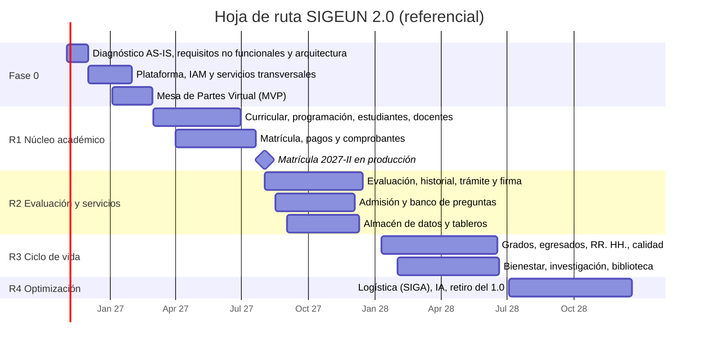

# 2. Propuesta técnica mejorada: cómo debe ejecutarse SIGEUN 2.0

Esta propuesta reemplaza las secciones V a X del plan original. Conserva su alineamiento estratégico (PEI/POI, CBC de SUNEDU) y su mapa de 16 módulos, y corrige los hallazgos del [análisis crítico](01-analisis-critico-del-plan.md). La arquitectura detallada está en [03-arquitectura-microservicios.md](03-arquitectura-microservicios.md) y las decisiones técnicas en [adr/](adr/README.md).

---

## 2.1 Principios rectores

1. **Programa, no proyecto de 4 meses.** SIGEUN 2.0 es un programa multianual (2026–2028) con entregas incrementales. Cada entrega pasa a producción y aporta valor por sí sola.
2. **Fundaciones antes que funcionalidades.** Primero la plataforma, la identidad, los datos maestros y las prácticas de ingeniería. Después los módulos de negocio.
3. **Reutilizar antes que construir.** Se construye solo lo que diferencia a la universidad. Se integran Moodle, Koha, DSpace, SIAF-RP, SIGA, AIRHSP y FirmaPerú (ADR-0006).
4. **Dominios, no organigramas.** Los servicios siguen capacidades de negocio. Facultad, escuela, sede y nivel son atributos y ámbitos de permiso.
5. **Migración progresiva.** El SIGEUN 1.0 se reemplaza por partes (*Strangler Fig*) y nunca se apaga de golpe (ADR-0007).
6. **Seguridad y privacidad desde el diseño.** Los controles se definen como requisitos, no como una actividad final.
7. **Todo como código.** Infraestructura, configuración, contratos de API, documentación y diagramas viven versionados en Git.
8. **El conocimiento queda en la universidad.** El código es institucional, la OTI participa en el equipo y la operación se transfiere con runbooks.

## 2.2 Alcance reformulado y hoja de ruta

El plan se aprobó el 24/09/2026, así que el tramo ejecutable de 2026 empieza, en la práctica, en noviembre. Se propone esta secuencia (las fechas deben ajustarse al calendario académico oficial):

| Entrega | Periodo | Objetivo | Servicios principales | Hito verificable |
|---|---|---|---|---|
| **Fase 0 – Fundaciones** | nov 2026 – feb 2027 | Plataforma, identidad, datos maestros, primer flujo de punta a punta | Plataforma K8s + CI/CD + observabilidad, IAM/SSO, API Gateway, `personas`, `organizacion`, `notificaciones`, `auditoria`, `documentos`, `tramite` (MVP), `interop-estado` (RENIEC), `legacy-acl` | **Mesa de Partes Virtual** en producción con SSO, validación de DNI y notificaciones |
| **R1 – Núcleo académico** | mar – jul 2027 | Que la matrícula 2027-II se haga en SIGEUN 2.0 | `curricular`, `programacion`, `matricula`, `estudiantes`, `docentes`, `pagos` (+ comprobantes SUNAT), `interop-mef` (SIAF), `lms-connector` (Moodle), `infraestructura` (ambientes), `reportes` | Matrícula 2027-II: piloto en una escuela y luego toda la universidad |
| **R2 – Evaluación y servicios** | ago – dic 2027 | Cerrar el ciclo académico 2027-II en SIGEUN 2.0 | `evaluacion`, `historial`, `tramite` completo + firma digital, `workflow`, `admision` + `banco-preguntas`, `tutoria`, almacén de datos y tableros (RTC) | Actas 2027-II cerradas en 2.0; admisión 2028-I en 2.0 |
| **R3 – Ciclo de vida completo** | ene – jun 2028 | Del ingreso al egreso | `grados-titulos` (+ SUNEDU), `egresados`, `rrhh` (+ AIRHSP), `calidad`, `bienestar`, `investigacion` (+ DSpace, CTI Vitae), `biblioteca-connector` (Koha) | Primer grado registrado ante SUNEDU desde 2.0 |
| **R4 – Optimización e IA** | jul – dic 2028 | Analítica avanzada y retiro del 1.0 | `logistica-patrimonio` (SIGA), `ia-asistente`, `analitica-predictiva`, `infraestructura` completo | **SIGEUN 1.0 en solo lectura** y plan de retiro aprobado |

**¿Por qué Mesa de Partes Virtual como primer flujo?** Recorre todas las capas de la arquitectura (portal público, SSO, gateway, servicio de dominio, documentos, notificaciones, auditoría, consulta a RENIEC) sin poner en riesgo el calendario académico. También da a la comunidad un resultado visible en pocos meses.

## 2.3 Metodología y ciclo de vida (NTP-ISO/IEC 12207)

Se usa un modelo **híbrido**: gobierno predictivo para presupuesto, contratos e hitos (lo que exige el sector público) y ejecución **ágil (Scrum)** con sprints de 2 semanas, planificación trimestral por entrega y demostraciones a los dueños de proceso al final de cada sprint. Para un equipo de este tamaño, la norma ISO/IEC 29110 (perfil básico) es una guía práctica compatible con la 12207.

Correspondencia entre procesos de la NTP-ISO/IEC 12207:2016 y prácticas del programa:

| Grupo 12207 | Proceso | Práctica concreta en SIGEUN 2.0 | Evidencia |
|---|---|---|---|
| Acuerdo | Adquisición / suministro | TDR con entregables verificables, cesión de derechos y SLA | TDR, actas de conformidad |
| Habilitación organizacional | Gestión del modelo de ciclo de vida | Este documento + Definición de Listo y de Terminado | DoR/DoD publicados |
| | Gestión de recursos humanos | Matriz de roles, plan de capacitación, inducción técnica | Plan de capacitación |
| | Gestión de la calidad | *Quality gates* en CI, revisión de código, auditorías por entrega | Reportes de SonarQube |
| Gestión técnica | Planificación del proyecto | Hoja de ruta, planificación de entregas y sprints | Backlog, plan de entrega |
| | Evaluación y control | Revisión de sprint, burn-up, DORA, comité mensual | Tablero de indicadores |
| | Gestión de decisiones | ADRs aprobados por la autoridad de diseño | `docs/adr/` |
| | Gestión de riesgos | Registro de riesgos revisado cada sprint | Registro de riesgos |
| | Gestión de la configuración | Git, trunk-based, SemVer, IaC, GitOps | Repositorios, *tags* |
| | Gestión de la información | Docs-as-code, wiki técnica, OpenAPI/AsyncAPI | Portal de desarrolladores |
| | Medición | Indicadores de producto, ingeniería y proyecto (sec. 2.17) | Tableros |
| | Aseguramiento de la calidad | Auditoría de cumplimiento de DoD por entrega | Informe de QA |
| Técnicos | Análisis de la misión / necesidades | Talleres de *Event Storming* y *User Story Mapping* con dueños de proceso | Mapa de historias |
| | Definición de requisitos | Historias con criterios de aceptación (BDD) + catálogo de requisitos no funcionales | Backlog, catálogo de RNF |
| | Definición de la arquitectura | Modelo C4, mapa de contextos, ADRs | Doc. 03 |
| | Diseño | Contratos de API primero, modelo de datos por servicio | OpenAPI, AsyncAPI |
| | Implementación | Plantilla estándar de microservicio, estándares de código | Código revisado |
| | Integración | CI en cada *commit*, pruebas de contrato | Pipeline verde |
| | Verificación | Pruebas automatizadas (unitarias, integración, contrato, E2E, carga, seguridad) | Reportes de pruebas |
| | Transición | Plan de *cutover*, migración ensayada, *hypercare* | Acta de pase a producción |
| | Validación | UAT con dueños de proceso sobre escenarios BDD | Acta de aceptación |
| | Operación | SRE, SLO, monitoreo, mesa de ayuda | Runbooks, reportes de SLO |
| | Mantenimiento | Gestión de incidentes y problemas, versiones correctivas | Tickets, *changelog* |
| | Disposición | Retiro controlado del SIGEUN 1.0 (archivo histórico) | Plan de retiro |

**Definición de Terminado (DoD) mínima por historia:** código revisado por al menos una persona y fusionado a `main`; pruebas automatizadas en verde y cobertura ≥ 80 % en el código nuevo de dominio; sin vulnerabilidades críticas o altas; contrato OpenAPI/AsyncAPI actualizado; desplegado en QA; criterios de aceptación validados por el dueño de proceso; documentación de usuario actualizada.

## 2.4 Ingeniería de requisitos

1. **Descubrimiento por dominio** con talleres de *Event Storming*: eventos como "Matrícula confirmada" o "Acta cerrada" revelan límites, reglas y responsables.
2. **User Story Mapping** para cortar entregas mínimas viables por dominio.
3. **Historias con criterios de aceptación en Gherkin (BDD)**, que después se automatizan como pruebas.
4. **Prototipos navegables (Figma o similar)** validados con usuarios antes de construir. Es la principal mitigación de la resistencia al cambio.
5. **Inventario normativo por dominio**: reglamento de matrícula, de evaluación, de grados, TUPA/TUSNE. Cada regla de negocio enlaza a su norma.
6. **Catálogo de requisitos no funcionales** (sec. 2.5), obligatorio para aceptar cualquier entrega.

## 2.5 Requisitos no funcionales (base ISO/IEC 25010)

| Característica | Requisito | Meta referencial |
|---|---|---|
| Disponibilidad | Servicios críticos (matrícula, pagos, portal estudiante) | ≥ 99.5 % mensual; ≥ 99.9 % en ventanas de matrícula y admisión |
| Desempeño | Tiempo de respuesta | p95 < 500 ms en consultas y < 1.5 s en transacciones |
| Capacidad | Pico de matrícula | Toda la población estudiantil intentando matricularse en la primera hora, con margen 2×. Se valida con prueba de carga antes de cada matrícula |
| Recuperabilidad | RPO / RTO | RPO ≤ 15 min (recuperación a un punto en el tiempo) y RTO ≤ 4 h; restauración probada cada trimestre |
| Seguridad | Estándar de verificación | OWASP ASVS nivel 2 (versión vigente) |
| Seguridad | Autenticación | SSO institucional; MFA obligatorio para roles administrativos y de registro de notas |
| Trazabilidad | Auditoría | 100 % de escrituras sobre notas, actas, pagos y grados registradas (quién, qué, cuándo, desde dónde, antes y después) en un almacén inmutable |
| Privacidad | Ambientes no productivos | Cero datos personales reales: datos anonimizados o sintéticos |
| Usabilidad | Escala SUS | ≥ 75 en pruebas con usuarios reales |
| Accesibilidad | WCAG | 2.1 nivel AA en portales públicos, de estudiante y de docente |
| Mantenibilidad | Calidad de código | Calificación A en SonarQube; cobertura ≥ 80 % en lógica de dominio |
| Interoperabilidad | Contratos | 100 % de APIs en OpenAPI 3.1 y eventos en AsyncAPI; ningún cambio incompatible sin nueva versión |
| Portabilidad | Despliegue | Contenedores OCI; un clúster nuevo se reconstruye desde Git en menos de 1 día |
| Compatibilidad | Clientes | Dos últimas versiones de Chrome, Edge, Firefox y Safari; diseño adaptable desde 360 px |
| Observabilidad | Telemetría | 100 % de servicios con logs estructurados, métricas RED y trazas distribuidas |

## 2.6 Calidad y estrategia de pruebas

| Nivel | Qué verifica | Herramienta sugerida | Cuándo |
|---|---|---|---|
| Unitarias | Reglas de dominio (prerrequisitos, créditos, promedios) | JUnit 5, Vitest | Cada *commit* |
| Integración | Servicio con su base de datos y el bus | Testcontainers | Cada *commit* |
| Contrato | Que productor y consumidor respeten la API o el evento | Pact o Spring Cloud Contract; `oasdiff` para cambios incompatibles | Cada *commit* |
| Componente / API | El servicio completo, aislado | REST Assured | Cada *merge* |
| End-to-end | Viajes críticos (matrícula, pago, trámite) | Playwright | Cada despliegue a QA |
| Carga | Picos de matrícula y admisión | k6 | Antes de cada ventana crítica |
| Seguridad | SAST, dependencias, contenedores, DAST | SonarQube/Semgrep, Trivy, OWASP ZAP | Pipeline + pentest por entrega |
| Accesibilidad | WCAG 2.1 AA | axe-core | Cada *merge* de frontend |
| Aceptación (UAT) | Escenarios BDD con dueños de proceso | Ambiente de preproducción | Cierre de cada entrega |

**Quality gate:** no se fusiona un *pull request* si fallan pruebas, si la cobertura del código nuevo es menor a 80 %, si aparecen vulnerabilidades críticas o altas, si se detectan secretos o si hay un cambio incompatible de contrato sin nueva versión.

## 2.7 DevSecOps y gestión de configuración

- **Repositorios institucionales** (organización de la UNAM en GitHub o GitLab autohospedado). Ningún código en cuentas personales.
- **Trunk-based development**: ramas cortas, *pull requests* con revisión obligatoria y `CODEOWNERS` por servicio.
- **Conventional Commits** y **versionado semántico**; *changelog* generado automáticamente.
- **Ambientes:** `dev` → `qa` → `staging` (preproducción con datos anonimizados) → `prod`. Producción va en un clúster separado.
- **Infraestructura como código** (OpenTofu/Ansible) y **GitOps** (Argo CD): lo que está en Git es lo que corre.
- **Cadena de suministro segura:** imágenes escaneadas (Trivy), firmadas (cosign), con SBOM (CycloneDX) y almacenadas en un registro privado (Harbor).
- **Secretos** en OpenBao/Vault con External Secrets, nunca en el repositorio (detección con `gitleaks`).
- **Despliegues progresivos** (*rolling* o *canary*) con *rollback* automático si fallan las pruebas de humo.

El pipeline completo está diagramado en el [doc. 03, sec. 3.12](03-arquitectura-microservicios.md#312-pipeline-cicd).

## 2.8 Seguridad de la información y protección de datos

| Control | Implementación |
|---|---|
| Gobierno | El programa se integra al SGSI institucional (NTP-ISO/IEC 27001), con un oficial de seguridad y confianza digital y un oficial de datos personales |
| Identidad | Keycloak con SSO (OIDC), federado con la cuenta Microsoft 365 institucional; MFA para roles críticos; cuentas de servicio con credenciales de cliente |
| Autorización | RBAC (rol) + ABAC (facultad, escuela, sede, nivel), aplicado en cada servicio, con mínimo privilegio |
| Borde | WAF con reglas OWASP CRS, limitación de tasa, CAPTCHA en formularios públicos, sala de espera virtual en matrícula y admisión |
| Cifrado | TLS 1.2+ externo, mTLS opcional entre servicios, cifrado en reposo de discos y respaldos |
| Datos biométricos | **No almacenar huellas.** Verificar identidad con el servicio biométrico de RENIEC y guardar solo el resultado y la evidencia |
| Ley N.° 29733 | Inventario y registro de bancos de datos personales, cláusulas de consentimiento, evaluación de impacto, minimización y plazos de conservación |
| Auditoría | Servicio `auditoria` con registro inmutable de operaciones sensibles y alertas por patrones anómalos (por ejemplo, cambios masivos de notas) |
| Vulnerabilidades | SAST, SCA, DAST y escaneo de imágenes en el pipeline; pentest externo antes de cada pase a producción |
| Respuesta a incidentes | Procedimiento de incidentes de seguridad, contacto con PECERT y simulacro anual |

## 2.9 Datos: modelo canónico, datos maestros y migración

**Modelo canónico vs. esquemas privados.** El "modelo de datos unificado" del plan se reemplaza por:

- **Modelo canónico**: glosario y estructuras compartidas (Persona, Programa, Periodo, Curso, Sección, Concepto de pago) que definen el lenguaje de los contratos de API y de los eventos.
- **Esquema privado por servicio**: cada servicio es dueño de sus tablas. Nadie consulta tablas ajenas. Los datos de otros dominios llegan por API o como copias locales alimentadas por eventos.
- **Datos maestros**: `personas` es el registro único (*golden record*) de toda persona (postulante, estudiante, docente, administrativo, egresado). Evita duplicados y se valida contra RENIEC.
- **Almacén de datos analítico**: los tableros y reportes institucionales salen de un almacén alimentado por CDC, nunca de las bases transaccionales.

**Migración desde el SIGEUN 1.0 (por dominio):**

1. Perfilamiento de datos: volumen, calidad, duplicados por DNI y huecos históricos.
2. Mapeo campo a campo hacia el modelo canónico y los esquemas de cada servicio.
3. Limpieza en origen junto con el custodio de datos (OTI + Registros Académicos).
4. Scripts ETL versionados, idempotentes y repetibles.
5. Al menos **dos ensayos de migración** en preproducción, con conciliación: conteos, sumas de control (créditos, montos, promedios) y muestreo validado por los dueños de proceso.
6. **Acta de conformidad de migración** firmada por el custodio de datos.
7. Corte en ventana planificada, con plan de reversa probado.
8. El SIGEUN 1.0 queda en solo lectura como archivo histórico. Las actas originales digitalizadas se conservan con su huella criptográfica (hash).

## 2.10 Equipo y organización

### Fase 0: mismo número de personas (13), otra composición

| Perfil | Cant. | Responsabilidad | Cambio respecto al plan |
|---|---|---|---|
| Jefe de proyecto / Scrum Master | 1 | Planificación, riesgos, impedimentos, informes | Se mantiene |
| **Arquitecto de software** | 1 | Arquitectura, ADRs, contratos, revisión técnica | **Nuevo** |
| **Ingeniero DevOps/SRE** | 1 | Clúster, CI/CD, observabilidad, respaldos | **Nuevo** |
| **Especialista en seguridad (DevSecOps)** | 1 | IAM, controles ASVS, pipeline seguro, privacidad | **Nuevo** |
| **Arquitecto de datos / DBA** | 1 | Modelo canónico, PostgreSQL, migración, CDC | **Nuevo** (se separa del perfil "UX/UI/BD") |
| Analista funcional | 2 | Descubrimiento, historias, BDD, UAT | +1 |
| Diseñador UX/UI | 1 | Investigación con usuarios, prototipos, sistema de diseño | Solo UX/UI |
| Desarrollador backend senior (líder técnico) | 3 | Servicios transversales y Mesa de Partes | −1 |
| Desarrollador frontend | 1 | Portales y sistema de diseño | −3 (en Fase 0 hay pocas pantallas) |
| QA de automatización | 1 | Estrategia de pruebas, automatización, pruebas de carga | Se orienta a automatización |
| Documentador | 0 | La documentación es continua y la produce cada rol (*docs-as-code*) | Se elimina |

**Participación obligatoria de la OTI:** al menos 2 servidores de planta (operación y desarrollo) trabajan en el equipo desde el día 1 para asegurar la continuidad.

### Desde 2027: equipos por dominio (*Team Topologies*)

| Equipo | Dominio | Composición referencial |
|---|---|---|
| Plataforma | Clúster, CI/CD, observabilidad, IAM, seguridad | 2 DevOps/SRE + 1 seguridad |
| Squad Académico | Curricular, programación, matrícula, evaluación, historial, tutoría, LMS | 1 líder técnico, 2 backend, 1–2 frontend, 1 QA, 1 analista |
| Squad Comunidad | Estudiantes, docentes, admisión, grados, egresados, bienestar, investigación | 1 líder técnico, 2 backend, 1 frontend, 1 QA, 1 analista |
| Squad Administración | Pagos, trámite, documentos, RR. HH., integraciones MEF/PIDE | 1 líder técnico, 2 backend, 1 frontend, 1 QA, 1 analista |
| Habilitadores | Arquitectura, datos/BI, UX, gestión | Arquitecto, arquitecto de datos, ingeniero de datos (desde R2), 1–2 UX/UI, jefe de proyecto |

Total referencial: **22–25 personas** (unos S/ 1.9–2.2 millones por año). Escenario mínimo: **16 personas con 2 squads**, extendiendo R3 y R4 hasta 2029. Los dueños de proceso (DASA, Escuelas, Tesorería, OGC, DBU, etc.) actúan como **Product Owners**, con dedicación formalizada por resolución.

## 2.11 Infraestructura y presupuesto 2026 reformulado

**Infraestructura mínima viable para microservicios en producción:**

- **3 nodos de cómputo homogéneos**, necesarios para el quórum de Kubernetes, de PostgreSQL replicado y del bus de mensajes. Con 2 nodos, cualquier falla detiene el sistema.
- **Almacenamiento de respaldo independiente** (NAS con *snapshots* inmutables) y **copia fuera del sitio** cifrada: sede Ilo, nube o ambas (regla 3-2-1).
- **Red de servidores de 10/25 GbE redundante.**
- El **servidor con GPU se difiere a R4 (IA)**. Comprarlo antes del caso de uso inmoviliza recursos en un equipo que perderá vigencia.
- Los periféricos (lectores biométricos, de código de barras y de tarjeta) se compran **con la entrega que los usa** (admisión, comedor, biblioteca).

**Presupuesto referencial con el mismo techo (S/ 747,800).** Todos los montos están sujetos a estudio de mercado. Mover recursos entre específicas de gasto requiere la modificación presupuestaria correspondiente.

| Rubro | Detalle | Monto ref. (S/) |
|---|---|---|
| **Servicios profesionales (4 meses)** | 13 perfiles de la sec. 2.10: arquitecto 9,000; DevOps 8,000; seguridad 7,500; datos 7,000; jefe de proyecto 7,000; 3 backend senior × 7,000; 2 analistas × 6,000; UX/UI 6,000; frontend 6,000; QA 5,500 (total mensual 89,000) | 356,000 |
| Nodos de cómputo (3) | 2 CPU con ≥ 24 núcleos, 256–384 GB RAM, ≥ 7.68 TB NVMe, 2 × 10/25 GbE, fuentes redundantes, 3 años de garantía | 240,000 |
| Respaldo | NAS con ≥ 40 TB útiles, *snapshots* inmutables y cifrado | 35,000 |
| Red de servidores | 2 switches de 10/25 GbE | 24,000 |
| Equipos del equipo (13) | Estación o laptop de desarrollo (12–16 núcleos, 32–64 GB, SSD 1 TB) × 5,500 | 71,500 |
| Monitores (13) | IPS de 27" QHD/4K con base ajustable × 1,200 | 15,600 |
| Impresión | 1 multifuncional láser para la oficina del proyecto | 3,500 |
| Medios de transporte de respaldo | 2 SSD externos cifrados × 800 | 1,600 |
| **Total** | | **747,200** |

Frente al plan original, este presupuesto incorpora los 4 perfiles críticos, alta disponibilidad real y respaldo independiente con el mismo monto total. Para eso elimina el servidor con GPU (hasta R4), reduce las estaciones sobredimensionadas, reemplaza los monitores OLED y baja las impresoras de 3 a 1.

> Si los servicios empiezan en noviembre de 2026, los 4 meses llegan hasta febrero de 2027 y requieren previsión presupuestal para 2027. La alternativa es ejecutar 2 meses en 2026 y continuar con el presupuesto 2027.

**Licencias:** el stack propuesto es de código abierto, sin costo de licencias. Cualquier software comercial requiere el informe técnico previo que exige la Ley N.° 28612.

## 2.12 Contratación y propiedad intelectual (TDR)

- **Entregables verificables**, no solo "informes de actividades". Por ejemplo: "servicio `personas` desplegado en QA, con pruebas en verde, OpenAPI publicado y demostración aceptada por el dueño de proceso".
- **Cesión de derechos patrimoniales** del software y la documentación a favor de la UNAM. Todo el código se entrega en el repositorio institucional durante la ejecución, no al final.
- Cláusulas de **confidencialidad y tratamiento de datos personales** (Ley N.° 29733).
- Requisitos de **experiencia verificable** por perfil (por ejemplo, el arquitecto debe acreditar sistemas distribuidos en producción).
- Para contrataciones que superen el umbral de contratación menor, aplicar el procedimiento de selección de la Ley N.° 32069.

## 2.13 Operación, soporte y continuidad

- **SLO por servicio crítico** con alertas y guardias en ventanas de matrícula y admisión.
- **Runbooks** por servicio: arranque, escalamiento, restauración y fallas típicas.
- **Mesa de ayuda** con niveles: N1 (soporte a usuarios), N2 (OTI) y N3 (equipo de desarrollo).
- ***Hypercare*** de 2 a 4 semanas después de cada pase a producción.
- **Congelamiento de cambios** durante las ventanas críticas (matrícula, cierre de actas, admisión).
- **Recuperación ante desastres:** procedimiento documentado y simulacro anual con restauración completa en el sitio alterno.

## 2.14 Gestión del cambio y capacitación

1. Mapa de actores e impacto por dominio, con comunicación antes, durante y después de cada entrega.
2. **Pilotos** con una escuela o facultad antes del despliegue general.
3. Formación de capacitadores en cada unidad, tutoriales cortos en video y ayuda dentro del sistema.
4. Encuesta SUS y de satisfacción después de cada entrega. Los resultados alimentan el backlog.
5. Red de "usuarios campeones" que participan desde los prototipos.

## 2.15 Gobernanza

| Instancia | Integrantes | Responsabilidad |
|---|---|---|
| Comité de Gobierno y Transformación Digital | Según R.M. N.° 119-2018-PCM y modificatorias | Aprueba el programa dentro del Plan de Gobierno Digital institucional |
| Patrocinador ejecutivo | Rector (Vicerrectorado Académico para el núcleo académico) | Alcance, prioridades y conflictos |
| Comité directivo | Rectorado + OTI + Planeamiento + Secretaría General + dueños de proceso | Prioridades trimestrales y control de cambios de alcance |
| **Autoridad de diseño** | Arquitecto + OTI + seguridad + arquitecto de datos | Aprueba ADRs, contratos transversales y estándares |
| Jefe de proyecto | OTI (coordinador) | Ejecución, riesgos e informes |
| **Product Owners** | Dueños de proceso designados por resolución | Backlog, priorización y aceptación |
| Custodio de datos | OTI + Registros Académicos | Calidad, migración y conformidad de datos |
| Oficiales | Seguridad y confianza digital; datos personales | Cumplimiento normativo |

**Cadencia:** revisión de sprint cada 2 semanas con los dueños de proceso (reemplaza a los "comités técnicos mensuales"), comité directivo mensual y planificación trimestral por entrega.

## 2.16 Gestión de riesgos (registro ampliado)

| ID | Riesgo | Prob. | Impacto | Mitigación |
|---|---|---|---|---|
| R-01 | Retraso en contratación y compras | Alta | Alto | Iniciar con un núcleo mínimo, contratos escalonados y especificaciones técnicas listas antes de la aprobación |
| R-02 | Talento sin experiencia en sistemas distribuidos | Alta | Alto | TDR con experiencia verificable, arquitecto y DevOps desde el inicio, plantilla estándar de servicio |
| R-03 | Complejidad operativa de los microservicios | Media | Alto | Granularidad media, plataforma estándar, observabilidad desde la Fase 0 |
| R-04 | Pérdida de conocimiento al terminar los contratos | Alta | Alto | OTI en el equipo, docs-as-code, runbooks, programación en pareja, continuidad presupuestal |
| R-05 | Errores en la migración de datos | Media | Alto | Ensayos, conciliación y acta firmada por el custodio |
| R-06 | Demora en convenios externos (PIDE, OSE de SUNAT, pasarela, SUNEDU) | Alta | Medio | Iniciar trámites en la Fase 0; simuladores mientras tanto |
| R-07 | Incidente de seguridad o fuga de datos personales | Media | Alto | ASVS L2, MFA, pentest, monitoreo, plan de respuesta |
| R-08 | Caída durante la matrícula o la admisión | Media | Alto | Pruebas de carga, alta disponibilidad, sala de espera virtual, congelamiento de cambios |
| R-09 | Resistencia al cambio | Alta | Medio | Prototipos con usuarios, pilotos, capacitación, *hypercare* |
| R-10 | Discontinuidad presupuestal 2027–2028 | Media | Alto | Programación multianual en PIA/POI; entregas con valor propio |
| R-11 | Ampliación descontrolada del alcance | Alta | Medio | Backlog priorizado por Product Owner y control de cambios en comité |
| R-12 | Dueños de proceso sin tiempo para validar | Media | Alto | Dedicación formalizada por resolución |
| R-13 | Falla de infraestructura | Media | Alto | 3 nodos, respaldo 3-2-1, sitio alterno |
| R-14 | Dependencia de un proveedor o tecnología | Baja | Medio | Código abierto, estándares abiertos, código propiedad de la UNAM |

## 2.17 Indicadores

| Tipo | Indicador | Meta referencial |
|---|---|---|
| Producto | % de trámites 100 % digitales | ≥ 80 % al cierre de R2 |
| Producto | Tiempo medio de matrícula por estudiante | < 15 min |
| Producto | % de pagos en línea | ≥ 70 % al cierre de R1 |
| Producto | Satisfacción (SUS) | ≥ 75 |
| Ingeniería (DORA) | Frecuencia de despliegue | Al menos semanal por servicio activo |
| Ingeniería (DORA) | Tiempo de entrega de cambios | < 1 semana |
| Ingeniería (DORA) | Tasa de fallos por cambio | < 15 % |
| Ingeniería (DORA) | Tiempo de recuperación (MTTR) | < 4 h |
| Ingeniería | Vulnerabilidades críticas o altas abiertas | 0 en producción |
| Operación | Disponibilidad en ventanas críticas | ≥ 99.9 % |
| Proyecto | Cumplimiento de hitos por entrega | ≥ 90 % |
| Proyecto | Índices de desempeño de costo y plazo (CPI/SPI) | ≥ 0.95 |
| CBC | Evidencias de indicadores SUNEDU generadas automáticamente | Creciente por entrega |

## 2.18 Entregables verificables de la Fase 0

| Mes | Entregable | Criterio de aceptación |
|---|---|---|
| 1 | Diagnóstico AS-IS del SIGEUN 1.0; inventario de integraciones; catálogo de requisitos no funcionales; arquitectura (C4 + ADRs); plan de proyecto; backlog de R1 | Aprobado por la autoridad de diseño y el comité directivo |
| 2 | Plataforma operativa: clústeres de producción y no producción, CI/CD, registro de imágenes, observabilidad, secretos, respaldos; IAM/SSO federado; API Gateway; plantilla de microservicio | Despliegue de un servicio de ejemplo desde Git y restauración de respaldo demostrada |
| 3 | Servicios `personas` (con RENIEC), `organizacion`, `notificaciones`, `auditoria` y `documentos` en preproducción; capa anticorrupción de lectura sobre el SIGEUN 1.0; especificación de migración | Pruebas de contrato en verde y demostración aceptada |
| 4 | **Mesa de Partes Virtual en producción**; pentest de la Fase 0 sin hallazgos críticos; runbooks; manuales; plan detallado de R1; transferencia a la OTI | Acta de pase a producción y acta de transferencia |

## 2.19 Normativa complementaria que debe añadirse a la base legal

- Ley N.° 29733, Ley de Protección de Datos Personales, y su Reglamento (D.S. N.° 016-2024-JUS).
- NTP-ISO/IEC 27001, de uso obligatorio en entidades públicas (R.M. N.° 004-2016-PCM y actualizaciones).
- D.U. N.° 006-2020 (Sistema Nacional de Transformación Digital) y D.U. N.° 007-2020 (Marco de Confianza Digital).
- Ley N.° 27269, Ley de Firmas y Certificados Digitales, y su Reglamento (D.S. N.° 052-2008-PCM).
- TUO de la Ley N.° 27444, Ley del Procedimiento Administrativo General (D.S. N.° 004-2019-JUS): plazos y notificación electrónica en trámites.
- TUO de la Ley N.° 27806, Ley de Transparencia y Acceso a la Información Pública (D.S. N.° 021-2019-JUS).
- Modelo de Gestión Documental (R.S.G.D. N.° 001-2017-PCM/SEGDI).
- Ley N.° 28612, que norma el uso, adquisición y adecuación del software en la administración pública.
- Ley N.° 31814, que promueve el uso de la inteligencia artificial, y su Reglamento.
- R.M. N.° 119-2018-PCM y modificatorias (Comité de Gobierno y Transformación Digital).
- Ley N.° 29973, Ley General de la Persona con Discapacidad (accesibilidad).
- Referencias técnicas: ISO/IEC 25010 (calidad de producto), ISO/IEC 29110 (ciclo de vida para equipos pequeños), OWASP ASVS (seguridad de aplicaciones).

> Antes de incorporar cada norma al documento oficial, la Oficina de Asesoría Jurídica debe confirmar su vigencia y sus modificatorias.
