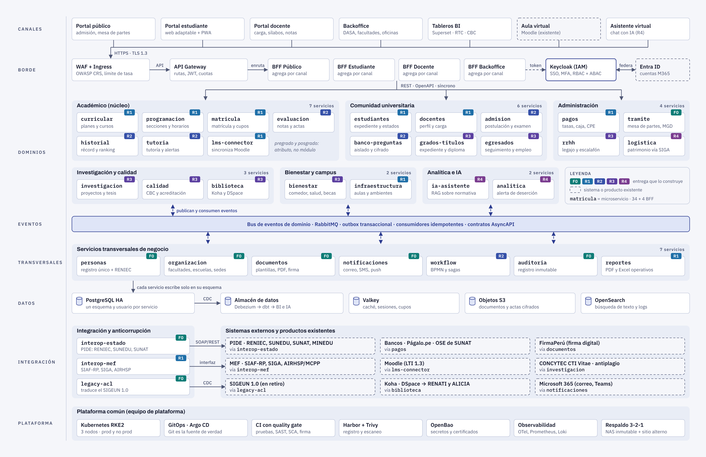
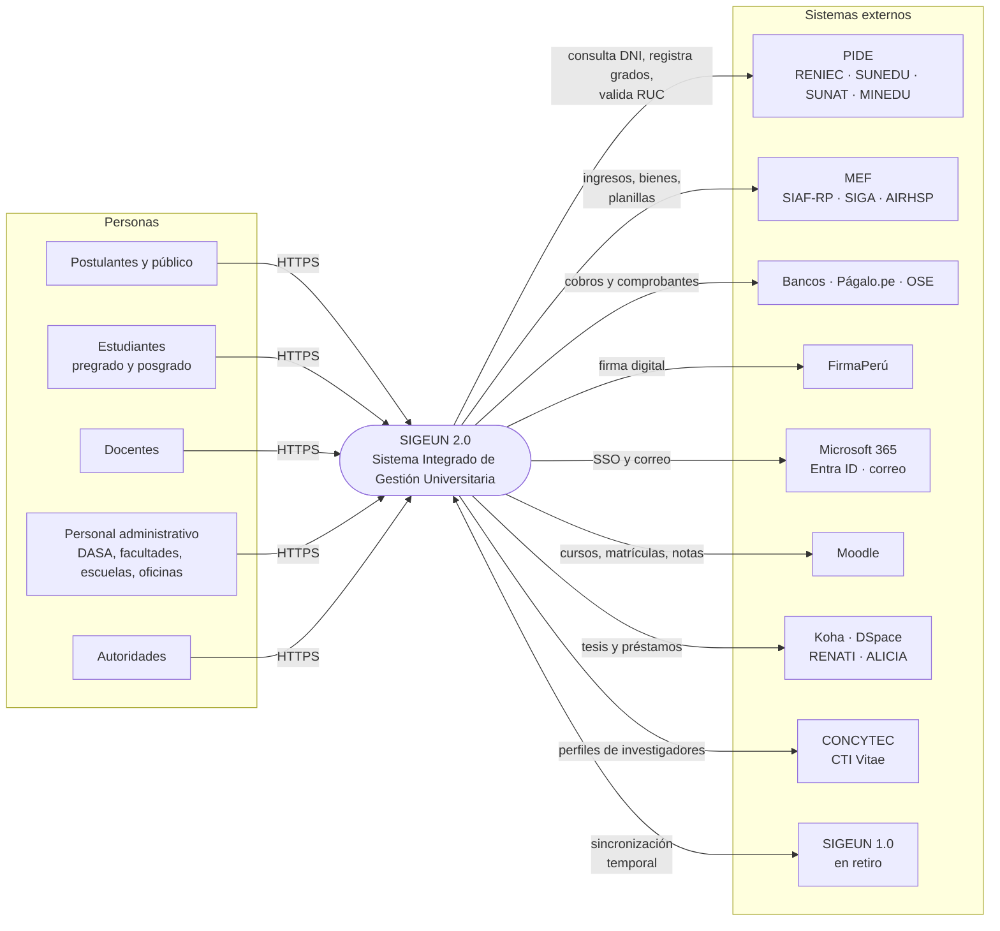
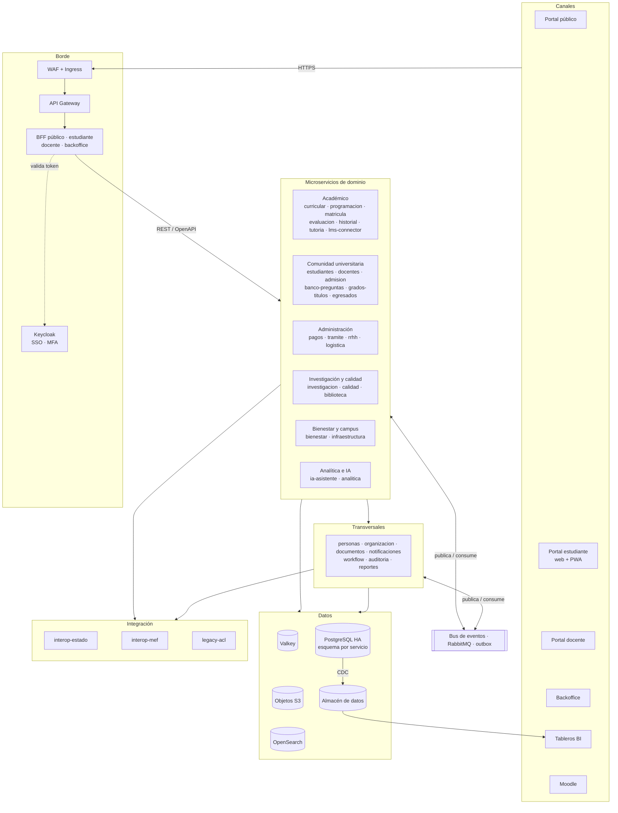
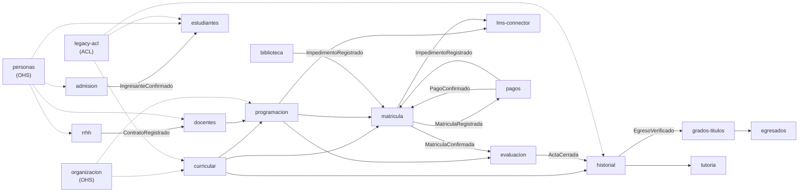
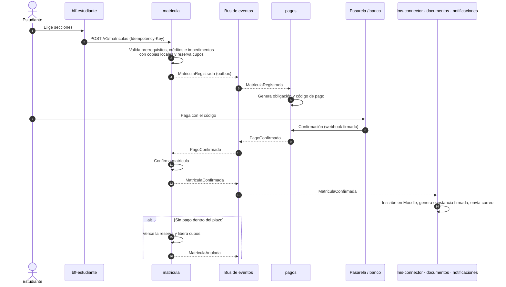
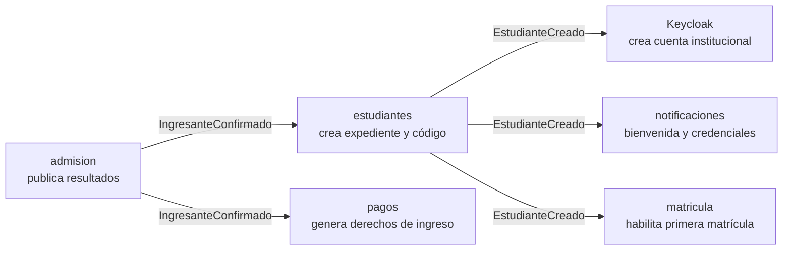
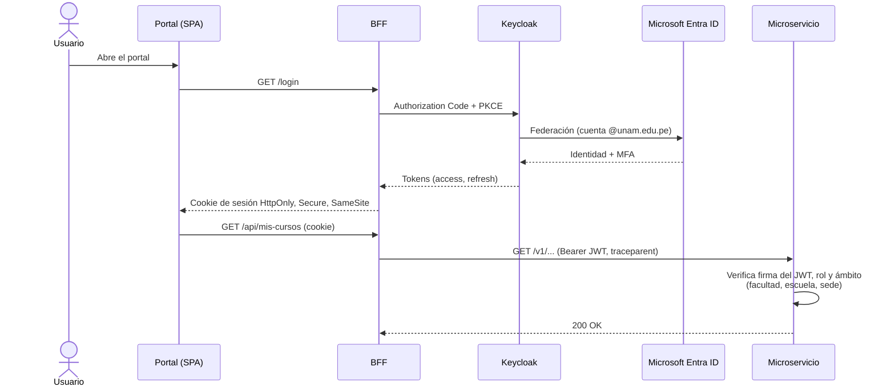
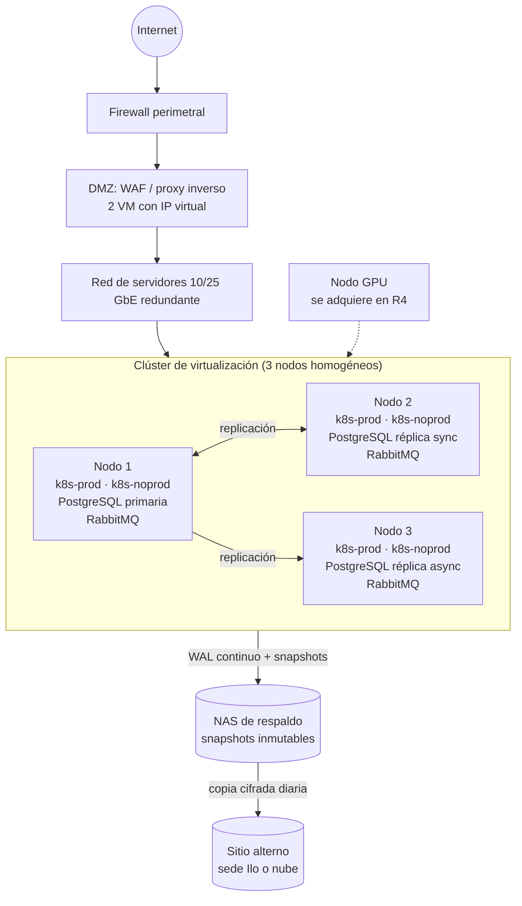
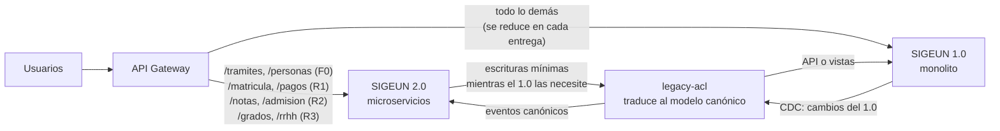

# 3. Arquitectura de microservicios SIGEUN 2.0

Este documento define la arquitectura objetivo del SIGEUN 2.0 con todos los módulos del plan. Sigue el modelo C4 (contexto, contenedores, componentes) y registra las decisiones en [ADRs](adr/README.md).

Diagramas principales (también en [`diagramas/`](../diagramas)):



| Diagrama | Archivo |
|---|---|
| Arquitectura completa por capas (34 microservicios + 4 BFF) | [`01-arquitectura-microservicios.svg`](../diagramas/01-arquitectura-microservicios.svg) / [`.png`](../diagramas/01-arquitectura-microservicios.png) |
| Saga de matrícula con pago | [`02-saga-matricula.svg`](../diagramas/02-saga-matricula.svg) / [`.png`](../diagramas/02-saga-matricula.png) |
| Migración progresiva desde el SIGEUN 1.0 | [`03-migracion-strangler.svg`](../diagramas/03-migracion-strangler.svg) / [`.png`](../diagramas/03-migracion-strangler.png) |
| Topología de despliegue | [`04-despliegue.svg`](../diagramas/04-despliegue.svg) / [`.png`](../diagramas/04-despliegue.png) |
| Página interactiva con todos los diagramas | [`sigeun2-arquitectura.html`](../diagramas/sigeun2-arquitectura.html) |

Los diagramas en Mermaid de este documento son la versión **"diagrama como código"**: se editan en Git y GitHub los muestra directamente.

---

## 3.1 Estilo arquitectónico y motivadores

**Estilo:** microservicios de **grano medio**, uno por *bounded context* (DDD), con comunicación híbrida (REST síncrono + eventos asíncronos) sobre una plataforma común Kubernetes. Ver [ADR-0001](adr/ADR-0001-microservicios-por-contexto-acotado.md).

**Motivadores:**

| Motivador | Consecuencia arquitectónica |
|---|---|
| Despliegue y versionado independiente por módulo (problema del monolito actual) | Un servicio = un contexto = un esquema de datos = un equipo dueño |
| Picos extremos en matrícula y admisión | Escalado horizontal por servicio, colas para nivelar carga, sala de espera virtual |
| Integración con muchos sistemas del Estado | Capa de integración anticorrupción con adaptadores aislados |
| Datos académicos con valor legal (actas, notas, grados) | Auditoría inmutable, correcciones por "rectificación" y nunca por sobrescritura |
| Equipo pequeño con rotación | Stack único, plantilla de servicio estándar, plataforma gestionada por un equipo dedicado |
| Convivencia con el SIGEUN 1.0 durante 2 años | Patrón *Strangler Fig* + capa anticorrupción |

**Reglas de granularidad:**

- Se separa un servicio cuando tiene **lenguaje, reglas y ritmo de cambio propios** y un dueño de proceso claro.
- **No** se separa por unidad orgánica (DASA, Facultad, Escuela) ni por nivel (pregrado/posgrado). Esos son **atributos y ámbitos de autorización**.
- Si dos servicios necesitan cambiar siempre juntos, deben fusionarse.

## 3.2 Contexto del sistema (C4 – nivel 1)



## 3.3 Vista de contenedores por capas (C4 – nivel 2)

La versión gráfica completa es el diagrama [`01-arquitectura-microservicios`](../diagramas/01-arquitectura-microservicios.png). Esta es su versión resumida como código:



## 3.4 Catálogo de microservicios

Entrega: **F0** = Fase 0 (nov 2026 – feb 2027), **R1** = mar–jul 2027, **R2** = ago–dic 2027, **R3** = ene–jun 2028, **R4** = jul–dic 2028.

### Dominio académico (núcleo)

| Servicio | Responsabilidad | Datos de los que es dueño | Publica | Consume | Entrega |
|---|---|---|---|---|---|
| `curricular` | Planes de estudio, cursos, créditos, prerrequisitos, equivalencias, competencias, sílabos | Plan, Curso, Prerrequisito, Sílabo | `PlanEstudiosAprobado`, `CursoActualizado` | `ProgramaCreado` | R1 |
| `programacion` | Periodos académicos, oferta, secciones, grupos, horarios, asignación de ambientes y carga lectiva | Periodo, Sección, Horario, CargaLectiva | `PeriodoAperturado`, `SeccionHabilitada`, `CargaAsignada` | `PlanEstudiosAprobado`, `AmbienteActualizado`, `DocenteVinculado` | R1 |
| `matricula` | Matrícula regular y extemporánea, retiros, reservas, cupos, validación de reglas | Matrícula, DetalleMatrícula, Cupo | `MatriculaRegistrada`, `MatriculaConfirmada`, `MatriculaAnulada` | `SeccionHabilitada`, `PagoConfirmado`, `ImpedimentoRegistrado/Levantado`, `PromedioCalculado` | R1 |
| `evaluacion` | Registro de notas, actas, rectificaciones, asistencia, cierre de periodo | Nota, Acta, Asistencia | `NotaRegistrada`, `ActaCerrada`, `NotaRectificada` | `MatriculaConfirmada`, `CargaAsignada` | R2 |
| `historial` | Récord académico, PPA/PPS, ranking, orden de mérito, verificación de egreso, constancias | Récord (modelo de lectura) | `PromedioCalculado`, `RankingPublicado`, `EgresoVerificado` | `ActaCerrada`, `PlanEstudiosAprobado` | R2 |
| `tutoria` | Tutoría y consejería, alertas tempranas, derivaciones a bienestar | Tutoría, Alerta | `AlertaGenerada` | `PromedioCalculado`, `RiesgoDesercionEstimado` | R2 |
| `lms-connector` | Sincroniza cursos, matrículas y notas con Moodle (LTI 1.3 + web services) | Mapeo de IDs | `NotaLMSImportada` | `SeccionHabilitada`, `MatriculaConfirmada` | R1 |

### Comunidad universitaria

| Servicio | Responsabilidad | Datos de los que es dueño | Publica | Consume | Entrega |
|---|---|---|---|---|---|
| `estudiantes` | Expediente del estudiante: programa, nivel (pregrado/posgrado), cohorte, estados, sanciones | Estudiante, EstadoEstudiante | `EstudianteCreado`, `EstadoEstudianteCambiado` | `IngresanteConfirmado`, `EgresoVerificado` | R1 |
| `docentes` | Perfil académico, categoría, dedicación, carga no lectiva, capacitación, evaluación de desempeño | Docente, Evaluación | `DocenteVinculado` | `ContratoRegistrado` (rrhh) | R1 |
| `admision` | Convocatorias, inscripción, postulantes, verificación biométrica, aulas de examen, resultados | Proceso, Postulante, Resultado | `PostulanteInscrito`, `ResultadosPublicados`, `IngresanteConfirmado` | `PagoConfirmado` | R2 |
| `banco-preguntas` | Banco de preguntas y armado de exámenes. **Aislado**, cifrado y con acceso mínimo | Pregunta, Examen | `ExamenGenerado` | — | R2 |
| `grados-titulos` | Expedientes de bachiller, título y posgrado, jurados, sustentación, diplomas, registro SUNEDU | Expediente, Diploma | `GradoOtorgado`, `DiplomaEmitido` | `EgresoVerificado`, `PagoConfirmado`, `DocumentoFirmado` | R3 |
| `egresados` | Seguimiento al egresado, encuestas de inserción laboral, bolsa de trabajo, empleadores | Egresado, Oferta | `OfertaPublicada` | `GradoOtorgado`, `EgresoVerificado` | R3 |

### Investigación, biblioteca y calidad

| Servicio | Responsabilidad | Entrega |
|---|---|---|
| `investigacion` | Proyectos, grupos, investigadores (CTI Vitae), fondos concursables, publicaciones, tesis, antiplagio, envío a DSpace | R3 |
| `biblioteca` | Conector con Koha (préstamos, multas como impedimentos) y DSpace (repositorio institucional para RENATI/ALICIA) | R3 |
| `calidad` | Licenciamiento (CBC), acreditación, indicadores, evidencias, planes de mejora, encuestas | R3 |

### Bienestar y campus

| Servicio | Responsabilidad | Entrega |
|---|---|---|
| `bienestar` | Comedor (beneficiarios y control de raciones), transporte, salud, psicopedagogía, deporte, actividades de formación integral, becas | R3 |
| `infraestructura` | Locales, sedes, pabellones, aulas, laboratorios, aforos, equipamiento, reservas de ambientes | R1 (básico), R4 (completo) |

### Administración

| Servicio | Responsabilidad | Integra con | Entrega |
|---|---|---|---|
| `pagos` | Catálogo de tasas (TUPA/TUSNE), obligaciones, pasarela, caja, conciliación, devoluciones, comprobantes electrónicos, impedimentos por deuda | Bancos, Págalo.pe, OSE/SUNAT, SIAF (vía `interop-mef`) | R1 |
| `tramite` | Mesa de partes virtual y física, expedientes, derivaciones, plazos, archivo, conforme al Modelo de Gestión Documental | `documentos`, `workflow`, `notificaciones` | F0 (MVP), R2 (completo) |
| `rrhh` | Legajo, escalafón, contratos, asistencia, licencias, capacitación, bienestar social; las planillas se integran, no se recalculan | AIRHSP/MCPP (vía `interop-mef`) | R3 |
| `logistica` | Requerimientos, consulta de bienes y patrimonio asignado, etiquetado e inventario | SIGA-MEF (vía `interop-mef`) | R4 |

### Transversales de negocio

| Servicio | Responsabilidad | Entrega |
|---|---|---|
| `personas` | **Registro único de personas** (*golden record*): identidad, documentos, contacto, roles. Valida contra RENIEC | F0 |
| `organizacion` | Estructura orgánica (facultades, escuelas, departamentos, oficinas, sedes), catálogos y ubigeo | F0 |
| `documentos` | Plantillas, generación de PDF, almacenamiento, firma digital (FirmaPerú), verificación por QR | F0 (base), R2 (firma) |
| `notificaciones` | Correo, SMS, push y notificaciones en el sistema, con plantillas y preferencias | F0 |
| `workflow` | Motor BPMN para flujos humanos (trámites, grados) y orquestación de sagas | R2 |
| `auditoria` | Registro inmutable de operaciones sensibles y consultas de cumplimiento | F0 |
| `reportes` | Reportes operativos (PDF/Excel) desde modelos de lectura | R1 |

### Analítica e IA

| Servicio | Responsabilidad | Entrega |
|---|---|---|
| `ia-asistente` | Asistente virtual con RAG sobre reglamentos y preguntas frecuentes, con derivación a una persona | R4 |
| `analitica` | Modelos predictivos (riesgo de deserción, demanda de secciones) sobre el almacén de datos | R4 |

### Integración y anticorrupción

| Servicio | Responsabilidad | Entrega |
|---|---|---|
| `interop-estado` | Adaptadores PIDE: RENIEC (DNI y biometría), SUNEDU (grados), SUNAT (RUC), MINEDU | F0 (RENIEC), R3 (SUNEDU) |
| `interop-mef` | Adaptadores SIAF-RP (registro de ingresos), SIGA (bienes), AIRHSP/MCPP (planillas) | R1 |
| `legacy-acl` | Capa anticorrupción con el SIGEUN 1.0: traduce su modelo al canónico durante la transición | F0 |

### Borde y canales

| Componente | Responsabilidad |
|---|---|
| WAF + Ingress | TLS, reglas OWASP CRS, limitación de tasa, protección contra bots |
| API Gateway | Enrutamiento, validación de JWT, cuotas, versionado, rutas hacia el SIGEUN 1.0 durante la migración |
| `bff-publico`, `bff-estudiante`, `bff-docente`, `bff-backoffice` | *Backend for Frontend*: agregan datos de varios servicios para un canal y guardan los tokens en el servidor (cookie `HttpOnly` en el navegador) |
| Keycloak (IAM) | SSO OIDC, MFA, federación con Microsoft Entra ID, roles y atributos de ámbito |

**Total:** 34 microservicios + 4 BFF. Unos 10 entran en la Fase 0.

## 3.5 Trazabilidad: 16 módulos del plan → microservicios

| # | Módulo del plan | Submódulos del plan | Microservicios |
|---|---|---|---|
| 1 | Académico | DASA, Facultades, Escuelas, Aula virtual, Seguimiento al egresado | `curricular`, `programacion`, `matricula`, `evaluacion`, `historial`, `lms-connector` + Moodle, `egresados`. DASA, Facultades y Escuelas son **ámbitos de autorización** del backoffice |
| 2 | Admisión | Inscripción, pago y biometría; banco de preguntas; calificación y resultados | `admision`, `banco-preguntas`, `pagos`, `personas` + RENIEC |
| 3 | Estudiantes | Pregrado, posgrado | `estudiantes` (nivel = atributo), `tutoria` |
| 4 | Docente | Pregrado, posgrado | `docentes`; la carga lectiva está en `programacion` |
| 5 | Investigación | Estudiantes, docentes | `investigacion` + DSpace, CTI Vitae |
| 6 | Calidad (SGC) | Licenciamiento (CBC), acreditación | `calidad` + almacén de datos |
| 7 | Bienestar universitario | Comedor, transporte, formación integral | `bienestar` |
| 8 | Grados y títulos | Grados, título profesional, bolsa de trabajo | `grados-titulos`, `egresados` (bolsa), `documentos` (diplomas firmados), `interop-estado` (SUNEDU) |
| 9 | Recursos humanos | Remuneraciones, escalafón, bienestar social | `rrhh` + AIRHSP/MCPP |
| 10 | Tesorería | Pago electrónico, pago en caja | `pagos` + bancos, OSE, SIAF |
| 11 | Logística y patrimonio | Logística, patrimonio | `logistica` + SIGA-MEF |
| 12 | Trámite documentario | Físico, virtual | `tramite`, `documentos`, `workflow`, `notificaciones` |
| 13 | Biblioteca | Física, virtual | `biblioteca` + Koha, DSpace |
| 14 | Infraestructura y ambientes | Infraestructura, ambientes | `infraestructura` |
| 15 | Reportes y tableros | RTC | `reportes`, almacén de datos, Superset |
| 16 | Inteligencia artificial | Asistente, analítica predictiva | `ia-asistente`, `analitica` |
| — | *No estaban en el plan* | — | IAM, API Gateway, BFFs, `personas`, `organizacion`, `notificaciones`, `documentos`, `workflow`, `auditoria`, `interop-estado`, `interop-mef`, `legacy-acl` |

## 3.6 Mapa de contextos

Relaciones *upstream → downstream* (quien publica → quien depende). OHS = *Open Host Service* con contrato publicado; ACL = capa anticorrupción.



## 3.7 Comunicación y contratos

### Reglas

1. **Comandos y consultas del usuario:** canal → BFF → servicio dueño, por REST síncrono.
2. **Procesos entre dominios:** por **eventos de dominio**. Coreografía para flujos simples y orquestación (`workflow` o una saga en el servicio dueño) para procesos con compensación, como matrícula con pago.
3. **No más de un salto síncrono** entre servicios. Si un servicio necesita datos de otro con frecuencia, mantiene una **copia local de solo lectura** alimentada por eventos (*event-carried state transfer*).
4. **Nadie lee la base de datos de otro servicio.** Los reportes cruzados salen del almacén de datos.
5. **Transactional outbox:** el evento se guarda en la misma transacción que el cambio y un *relay* lo publica. Entrega "al menos una vez" con consumidores **idempotentes** y cola de mensajes fallidos (DLQ).
6. **Impedimentos:** cualquier dominio que genere un bloqueo (deuda económica, deuda de biblioteca, sanción) publica `ImpedimentoRegistrado` o `ImpedimentoLevantado`. Matrícula y grados mantienen la vista consolidada sin consultar a cada dominio.

### Convenciones de API

| Tema | Convención |
|---|---|
| Especificación | OpenAPI 3.1 (*contract-first*); eventos en AsyncAPI 3 |
| Versionado | En la ruta (`/v1/...`); los cambios incompatibles van a `/v2` y se mantiene `/v1` durante un periodo de deprecación |
| Errores | `application/problem+json` (RFC 9457) |
| Idempotencia | Cabecera `Idempotency-Key` en matrícula, pagos y trámites |
| Trazabilidad | `traceparent` (W3C Trace Context) propagado en HTTP y en los mensajes |
| Identificadores | UUID como clave técnica; DNI y códigos institucionales como atributos únicos |
| Fechas | ISO 8601 en UTC; se muestran en `America/Lima` |
| Paginación | Por cursor (`?cursor=&limit=`) |
| Registros académicos | Nunca se borran ni se sobrescriben: se corrigen con una rectificación auditada |

### Catálogo de eventos (núcleo)

| Evento | Productor | Consumidores principales |
|---|---|---|
| `PersonaActualizada` | personas | todos los que guardan datos de personas |
| `PlanEstudiosAprobado` | curricular | programacion, matricula, historial |
| `SeccionHabilitada` | programacion | matricula, lms-connector, evaluacion |
| `CargaAsignada` | programacion | docentes, evaluacion |
| `IngresanteConfirmado` | admision | estudiantes, pagos, notificaciones |
| `MatriculaRegistrada` | matricula | pagos |
| `PagoConfirmado` | pagos | matricula, admision, grados-titulos, tramite |
| `MatriculaConfirmada` | matricula | evaluacion, lms-connector, documentos, notificaciones, historial |
| `ImpedimentoRegistrado` / `ImpedimentoLevantado` | pagos, biblioteca, estudiantes | matricula, grados-titulos |
| `ActaCerrada` | evaluacion | historial, calidad |
| `EgresoVerificado` | historial | estudiantes, grados-titulos, egresados |
| `GradoOtorgado` | grados-titulos | interop-estado (SUNEDU), egresados, documentos |
| `ExpedienteRegistrado` / `ExpedienteDerivado` | tramite | notificaciones, workflow |
| `DocumentoFirmado` | documentos | tramite, grados-titulos |

## 3.8 Flujo clave: saga de matrícula con pago



**Por qué así:** la matrícula nunca espera en línea a que responda el banco; el cupo se reserva de inmediato y se libera solo si vence el plazo. Si `pagos` está caído, la matrícula se registra igual y se confirma cuando el servicio vuelve. En los días pico, los contadores de cupos usan operaciones atómicas en la base de datos de `matricula` (o en Valkey), y una **sala de espera virtual** en el borde regula la entrada.

## 3.9 Flujo: de postulante a estudiante



## 3.10 Arquitectura de datos

- **Base de datos por servicio:** clúster PostgreSQL de alta disponibilidad (CloudNativePG: 1 primaria + 2 réplicas en nodos distintos) con **un esquema y un usuario por servicio**, sin permisos cruzados. Los servicios críticos o de mucha carga (`matricula`, `pagos`, `banco-preguntas`) pueden pasar a una instancia propia sin cambiar código ([ADR-0002](adr/ADR-0002-base-de-datos-por-servicio-postgresql.md)).
- **Modelos de lectura (CQRS)** en `historial`, `reportes` y los BFF para consultas pesadas.
- **Almacén de datos:** CDC con Debezium desde las réplicas → zona *raw* → transformaciones versionadas con dbt → modelos dimensionales → Superset (tableros RTC e indicadores CBC) y `analitica`.
- **Objetos:** documentos, actas digitalizadas y adjuntos en almacenamiento S3 compatible, cifrado, con *object lock* para documentos con valor legal.
- **Búsqueda:** OpenSearch para búsqueda de texto completo (expedientes, normativa) y para logs.
- **Conservación:** plazos definidos por serie documental según la normativa archivística, con anonimización para analítica.

## 3.11 Seguridad



| Capa | Control |
|---|---|
| Identidad | SSO OIDC con Keycloak federado a Entra ID; MFA obligatorio para roles administrativos y de notas; cuentas de servicio con *client credentials* |
| Autorización | RBAC (rol) + ABAC (`facultad_id`, `escuela_id`, `sede`, `nivel`) aplicado en cada servicio con una librería común de políticas (OPA opcional) |
| Sesión en el navegador | Los tokens nunca llegan al navegador: el BFF los guarda y entrega una cookie `HttpOnly` |
| Red | Políticas de red de Kubernetes (deny-all por defecto), mTLS opcional con service mesh ligero |
| Secretos | OpenBao/Vault + External Secrets; rotación periódica |
| Datos | Cifrado en tránsito y en reposo; datos biométricos no se almacenan (verificación RENIEC) |
| Auditoría | Eventos de auditoría hacia `auditoria` (almacenamiento inmutable) con alertas por patrones anómalos |
| Cadena de suministro | SBOM, escaneo de imágenes, firma con cosign, admisión solo de imágenes firmadas |

## 3.12 Pipeline CI/CD

```mermaid
flowchart LR
  A["Commit y<br/>pull request"] --> B["Build +<br/>pruebas unitarias"]
  B --> C["Integración<br/>Testcontainers"]
  C --> D["Contrato<br/>Pact · oasdiff"]
  D --> E["SAST · SCA ·<br/>secretos"]
  E --> F{"Quality<br/>gate"}
  F -- falla --> A
  F -- pasa --> G["Imagen OCI<br/>+ SBOM + firma"]
  G --> H["Harbor<br/>+ escaneo Trivy"]
  H --> I["GitOps: dev<br/>automático"]
  I --> J["QA: E2E<br/>Playwright + DAST"]
  J --> K["Staging:<br/>UAT + carga k6"]
  K --> L{"Aprobación<br/>de cambio"}
  L --> M["Producción<br/>rolling / canary"]
  M --> N["Pruebas de humo<br/>+ SLO"]
  N -- degradación --> O["Rollback<br/>automático"]
```



## 3.13 Topología de despliegue



- **Clústeres separados** para producción y no producción (`dev`, `qa`, `staging`), ambos con nodos repartidos en los 3 hosts.
- Antiafinidad: ninguna réplica de un mismo servicio crítico comparte host.
- **RPO ≤ 15 min** con WAL continuo; **RTO ≤ 4 h** con restauración probada cada trimestre.
- Escalado horizontal automático (HPA) en `matricula`, `pagos`, `admision` y los BFF.

## 3.14 Observabilidad

- **OpenTelemetry** en cada servicio (agente automático + spans de negocio) → Collector → **Prometheus** (métricas), **Loki** (logs), **Tempo** (trazas) → **Grafana**.
- Tablero estándar por servicio con métricas **RED** (tasa, errores, duración) y **USE** para la infraestructura.
- **SLO** por servicio crítico con alertas por consumo del presupuesto de error.
- Logs JSON estructurados con `trace_id`, `usuario`, `servicio` y `version`, **sin datos personales sensibles**.
- Monitoreo sintético de los viajes críticos (login, matrícula, pago) cada 5 minutos.

## 3.15 Migración progresiva desde el SIGEUN 1.0 (Strangler Fig)



1. **F0:** el API Gateway se pone delante del SIGEUN 1.0 sin cambiar nada para el usuario. `legacy-acl` empieza a leer cambios del 1.0.
2. **Cada entrega** mueve rutas al 2.0 después de migrar los datos de ese dominio, con acta de conciliación.
3. Mientras un dominio siga en el 1.0 y necesite datos del 2.0 (por ejemplo, notas en 1.0 con matrícula en 2.0 durante 2027-II), `legacy-acl` escribe lo mínimo de vuelta.
4. **R4:** el 1.0 queda en solo lectura como archivo histórico y se aprueba su retiro.

## 3.16 Stack tecnológico

| Capa | Elección | Alternativas válidas | Motivo |
|---|---|---|---|
| Backend | Java 21/25 LTS + Spring Boot (versión con soporte vigente) | .NET 8+, Kotlin | Talento disponible en Perú, ecosistema maduro (Resilience4j, Spring Security, Testcontainers) |
| Analítica e IA | Python 3.12+ (FastAPI, scikit-learn) | — | Ecosistema de datos |
| Frontend | React + TypeScript + Vite, sistema de diseño propio | Angular | Componentes reutilizables entre portales; PWA |
| API Gateway | Apache APISIX | Kong, Spring Cloud Gateway | Código abierto, plugins de JWT y limitación de tasa |
| IAM | Keycloak | — | OIDC/SAML, MFA, federación con Entra ID |
| Mensajería | RabbitMQ (colas *quorum*) | Kafka/Redpanda si crece el volumen | Operación simple a esta escala |
| Base de datos | PostgreSQL 16/17 + CloudNativePG | — | Estándar, sin licencias, alta disponibilidad nativa en Kubernetes |
| Caché | Valkey | Redis | Licencia abierta |
| Objetos | S3 compatible (Ceph RGW vía Rook, SeaweedFS) | MinIO | Documentos y respaldos |
| Búsqueda / logs | OpenSearch + Loki | Elasticsearch | Licencia abierta |
| Workflow | Flowable (BPMN) | Temporal (sagas de código) | Flujos humanos de trámites y grados |
| Almacén de datos | PostgreSQL o ClickHouse + Debezium + dbt + Superset | Metabase | Código abierto |
| Plataforma | Kubernetes RKE2 sobre Proxmox VE | Talos, K3s | Sin costo de licencias de virtualización |
| GitOps / CI | Argo CD + GitHub Actions o GitLab CI | Flux | Despliegue declarativo |
| Registro | Harbor + Trivy | — | Escaneo y firma de imágenes |
| Secretos | OpenBao + External Secrets | Vault | Licencia abierta |
| Observabilidad | OpenTelemetry, Prometheus, Loki, Tempo, Grafana | — | Estándar abierto |
| Calidad | SonarQube, Semgrep, OWASP ZAP, k6, Playwright, Pact | — | Quality gates automáticos |

## 3.17 Repositorios y plantilla de servicio

| Repositorio | Contenido |
|---|---|
| `sigeun2.0` (este) | Arquitectura, ADRs, diagramas, estándares |
| `sigeun-services` | Monorepo de backend: un módulo por microservicio, con build e imagen independientes y `CODEOWNERS` por carpeta |
| `sigeun-web` | Monorepo de frontend: portales + sistema de diseño |
| `sigeun-contracts` | OpenAPI y AsyncAPI versionados; genera clientes y documentación |
| `sigeun-platform` | Infraestructura como código (OpenTofu, Ansible, charts de Helm) |
| `sigeun-gitops` | Estado deseado por ambiente para Argo CD |

**Plantilla estándar de microservicio** (todo servicio nace de ella):

```
servicio/
├── src/main/java/.../
│   ├── api/              # controladores REST generados desde OpenAPI
│   ├── application/      # casos de uso
│   ├── domain/           # entidades, reglas, eventos de dominio (sin dependencias de framework)
│   └── infrastructure/   # repositorios, outbox, mensajería, clientes externos
├── src/test/             # unitarias, integración (Testcontainers), contrato (Pact)
├── db/migration/         # Flyway: migraciones versionadas del esquema propio
├── openapi.yaml          # contrato publicado
├── asyncapi.yaml         # eventos publicados y consumidos
├── Dockerfile            # imagen mínima, usuario no root
├── helm/                 # chart con HPA, PDB, NetworkPolicy, probes
└── README.md             # propósito, dueño, SLO, runbook
```

Incluye por defecto: *health checks*, métricas, trazas, logs estructurados, *outbox* y validación de JWT con ámbitos.
