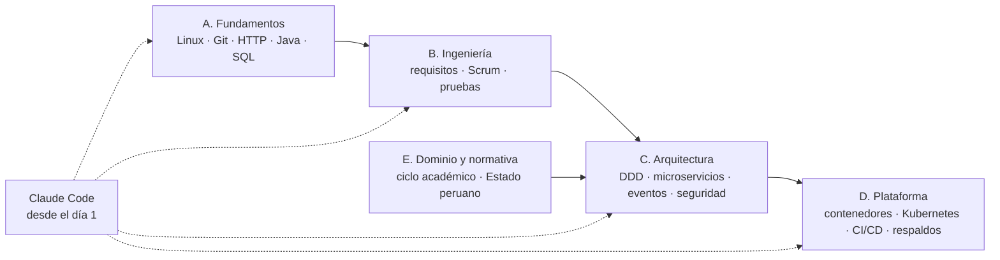
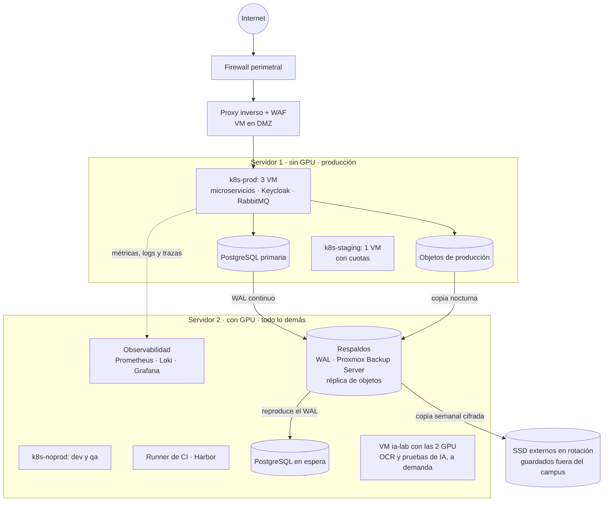
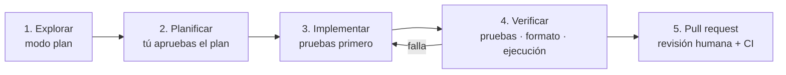

# 4. Guía de estudio SIGEUN 2.0: de cero a la Fase 0, con Claude Code

> Para el equipo que construirá el SIGEUN 2.0 en la Universidad Nacional de Moquegua.
> Versión del 12/10/2026. Usa como hardware los **equipos del Plan de Trabajo v01, sin cambios** (ver [sección 7](#7-los-equipos-del-plan-cómo-sacarles-provecho) y [ADR-0010](adr/ADR-0010-despliegue-con-los-equipos-del-plan.md)).

Esta guía responde a una sola pregunta: **¿qué tengo que saber, y en qué orden, para empezar a construir el SIGEUN 2.0 y no equivocarme en lo importante?** Va desde lo básico (terminal, Git, SQL) hasta la arquitectura de microservicios, la operación de los servidores y el uso de Claude Code como herramienta de trabajo diario.

---

## Contenido

0. [Cómo usar esta guía](#0-cómo-usar-esta-guía)
1. [Lo que vas a construir, en una página](#1-lo-que-vas-a-construir-en-una-página)
2. [Bloque A. Fundamentos](#2-bloque-a-fundamentos)
3. [Bloque B. Ingeniería de software](#3-bloque-b-ingeniería-de-software)
4. [Bloque C. Arquitectura](#4-bloque-c-arquitectura)
5. [Bloque D. Plataforma y operación](#5-bloque-d-plataforma-y-operación)
6. [Bloque E. Dominio universitario y Estado peruano](#6-bloque-e-dominio-universitario-y-estado-peruano)
7. [Los equipos del plan: cómo sacarles provecho](#7-los-equipos-del-plan-cómo-sacarles-provecho)
8. [El equipo: roles del plan con responsabilidades claras](#8-el-equipo-roles-del-plan-con-responsabilidades-claras)
9. [Claude Code para el SIGEUN 2.0](#9-claude-code-para-el-sigeun-20)
10. [Plan de estudio de 8 semanas y proyecto de práctica](#10-plan-de-estudio-de-8-semanas-y-proyecto-de-práctica)
11. [Los primeros 30 días del proyecto](#11-los-primeros-30-días-del-proyecto)
12. [Glosario](#12-glosario)
13. [Recursos recomendados](#13-recursos-recomendados)

---

## 0. Cómo usar esta guía

**Cada tema tiene la misma estructura:**

- **Qué aprender:** la lista concreta de conceptos.
- **Por qué importa aquí:** dónde lo vas a usar en el SIGEUN 2.0.
- **Práctica:** un ejercicio corto y real.
- **Compruébalo:** casillas para autoevaluarte. Si no puedes marcarlas todas, repasa.
- **Con Claude Code:** cómo usarlo para aprender o hacer ese tema más rápido.

**Niveles:** 🟢 imprescindible antes de escribir código del proyecto · 🟡 necesario durante la Fase 0 · 🔵 necesario antes de R1 (2027).

**Ruta por rol.** No todos estudian todo. Marca tu fila:

| Rol | Bloques obligatorios | Bloques de lectura |
|---|---|---|
| Coordinador / jefe de proyecto | B, E, 8, 9.1–9.4, 11 | A2, C1, C8, D6 |
| Analista funcional | B1, B2, C1, E | A2, A7, C4 |
| Diseñador UX/UI | B1, E1, E2 | A2, A5, C4 |
| Programador senior | A, B, C, D | E |
| Programador junior | A, B3, B4, C3, C4, C5 | C1, D1, D2 |
| QA | A1, A2, A7, B1, B3 | C4, C5, D4 |
| Documentador | A2, B1, C8 | C1, E |
| Responsable de plataforma (un senior) | A1, A3, D completo, C7 | C2, C6 |

**Tiempo:** unas 8 a 10 horas por semana de estudio y práctica durante 8 semanas (ver [sección 10](#10-plan-de-estudio-de-8-semanas-y-proyecto-de-práctica)).

---

## 1. Lo que vas a construir, en una página

El SIGEUN 2.0 reemplaza al SIGEUN 1.0 (un monolito) por **34 microservicios organizados por dominio de negocio**, construidos por entregas entre noviembre de 2026 y diciembre de 2028. Lee primero, en este orden:

1. [Análisis crítico del plan](01-analisis-critico-del-plan.md): qué estaba mal y por qué.
2. [Arquitectura de microservicios](03-arquitectura-microservicios.md): el diagrama general y el catálogo de servicios.
3. [Propuesta técnica](02-propuesta-tecnica-mejorada.md): cómo se trabaja (metodología, pruebas, seguridad).
4. [ADRs](adr/README.md): las decisiones técnicas y su porqué.

**Diez ideas que todo el equipo debe poder explicar con sus palabras:**

1. Un **microservicio** es una aplicación pequeña que se despliega sola, es dueña de sus datos y resuelve un dominio de negocio (por ejemplo, `matricula`).
2. Los servicios se separan por **dominio**, no por oficina: DASA, Facultad y Escuela son *permisos*, no módulos.
3. **Nadie lee la base de datos de otro servicio.** Si necesitas datos ajenos, los pides por API o recibes sus eventos.
4. Cuando un usuario pide algo, se usa **REST** (síncrono). Cuando un dominio avisa a otro, se usa un **evento** (asíncrono).
5. El patrón **outbox** garantiza que un cambio y su evento se guarden juntos o no se guarden.
6. Los consumidores de eventos son **idempotentes**: procesar el mismo evento dos veces no causa daño.
7. El **SIGEUN 1.0 se reemplaza por partes** (*Strangler Fig*): el API Gateway envía cada ruta al sistema que corresponda.
8. Todo vive en **Git**: código, infraestructura, contratos, documentación y diagramas.
9. **Ningún dato personal real** sale de producción: ni a los ambientes de prueba ni a herramientas externas, incluida la IA.
10. Una tarea está **terminada** cuando tiene pruebas, revisión, contrato actualizado y está desplegada en QA, no cuando "funciona en mi máquina".

**Mapa de aprendizaje:**



---

## 2. Bloque A. Fundamentos

### A1. Terminal y Linux 🟢

**Qué aprender:** navegar directorios (`cd`, `ls`, `pwd`), archivos (`cat`, `less`, `cp`, `mv`, `rm`), permisos (`chmod`, `chown`), procesos (`ps`, `top`, `kill`), redirecciones y tuberías (`>`, `|`, `grep`), variables de entorno, `ssh` y llaves SSH, gestor de paquetes (`apt`), `systemctl` y `journalctl`, editar con `nano` o `vim` básico.

**Por qué importa aquí:** los servidores corren Linux (Proxmox VE y las VMs), los contenedores son Linux, y en las estaciones Windows trabajarás dentro de **WSL2 (Ubuntu)**.

**Práctica:** instala WSL2 en tu estación, crea una llave SSH, busca con `grep -r` todas las apariciones de una palabra en un proyecto y guarda el resultado en un archivo.

**Compruébalo:**
- [ ] Sé moverme por el sistema de archivos sin interfaz gráfica.
- [ ] Sé leer los logs de un servicio con `journalctl -u`.
- [ ] Sé conectarme a un servidor con llave SSH, sin contraseña.

**Con Claude Code:** pídele *"Explícame qué hace este comando línea por línea"* antes de ejecutar algo que no entiendes. Nunca ejecutes en un servidor un comando que no puedas explicar.

### A2. Git y GitHub 🟢

**Qué aprender:** `clone`, `status`, `add`, `commit`, `log`, `diff`, ramas (`switch -c`), `merge` vs `rebase`, resolver conflictos, `pull request`, revisión de código, **Conventional Commits** (`feat:`, `fix:`, `docs:`...), versionado semántico (MAJOR.MINOR.PATCH), `.gitignore`, protección de ramas y `CODEOWNERS`.

**Por qué importa aquí:** el proyecto trabaja con *trunk-based development* ([ADR-0009](adr/ADR-0009-repositorios-y-flujo-de-trabajo.md)): ramas cortas que se fusionan a `main` en uno o dos días, siempre por *pull request* revisado. El código vive en la organización institucional, nunca en cuentas personales.

**Práctica:** crea una rama, haz dos commits con Conventional Commits, abre un PR, pide revisión a un compañero, resuelve sus comentarios y fusiona.

**Compruébalo:**
- [ ] Sé resolver un conflicto de *merge* sin perder trabajo.
- [ ] Sé deshacer un commit local (`git restore`, `git reset --soft`) y uno publicado (`git revert`).
- [ ] Escribo mensajes de commit que explican el *porqué*.

**Con Claude Code:** *"Revisa mi diff y propón un mensaje de commit en formato Conventional Commits"*. Claude Code puede hacer commits, pero **tú revisas el diff antes**.

### A3. Redes y HTTP 🟢

**Qué aprender:** IP, puertos, DNS, TCP vs UDP, HTTP (métodos, códigos de estado, cabeceras, cookies), HTTPS y certificados TLS, proxy inverso, balanceador, VLAN, NAT y firewall a nivel conceptual.

**Por qué importa aquí:** todo pasa por HTTP: portal → WAF → API Gateway → BFF → microservicio. En los servidores tendrás que separar redes (DMZ, servidores, gestión).

**Práctica:** usa `curl -v https://www.gob.pe` y explica cada línea de la respuesta. Identifica el certificado, el código de estado y las cabeceras.

**Compruébalo:**
- [ ] Sé la diferencia entre 401 y 403, y entre 400 y 422.
- [ ] Sé qué hace un proxy inverso y por qué el WAF va delante del gateway.

### A4. Java moderno y Spring Boot 🟢 (backend)

**Qué aprender:**
- **Java 21:** `record`, `sealed interface`, *pattern matching* en `switch`, `Optional`, *streams*, *text blocks*, hilos virtuales, manejo de excepciones.
- **Spring Boot:** inyección de dependencias, Spring Web (controladores REST), validación (`@Valid`), Spring Data JDBC/JPA, Flyway (migraciones), Spring Security como *resource server* (JWT), Actuator (salud y métricas), Spring AMQP (RabbitMQ), configuración por perfiles.
- **Gradle:** tareas, dependencias, proyectos multimódulo.

**Por qué importa aquí:** es el stack estándar de los microservicios ([ADR-0008](adr/ADR-0008-stack-tecnologico-estandar.md)).

**Práctica:** construye un servicio con un endpoint `POST /v1/expedientes` que valide la entrada, guarde en PostgreSQL con Flyway y devuelva `201 Created`.

**Compruébalo:**
- [ ] Sé crear un proyecto Spring Boot desde cero con Spring Initializr.
- [ ] Sé escribir una migración Flyway y explicar por qué **nunca se edita una migración ya aplicada**.
- [ ] Sé exponer `/actuator/health` y entender qué indica.

**Con Claude Code:** pídele que genere el esqueleto, pero escribe tú la primera regla de negocio. Después pídele: *"Revisa mi implementación como si fueras un senior exigente; no me des el código corregido, dime qué mejorar"*.

### A5. TypeScript y React 🟡 (frontend)

**Qué aprender:** tipos, interfaces, *generics*, `async/await`, módulos; React con componentes funcionales, *hooks* (`useState`, `useEffect`), formularios, rutas, consumo de APIs, manejo de errores y estados de carga; accesibilidad básica (etiquetas, contraste, foco del teclado); Vite.

**Por qué importa aquí:** los portales (público, estudiante, docente, backoffice) comparten un **sistema de diseño**. Deben ser accesibles (WCAG 2.1 AA) y funcionar desde 360 px de ancho.

**Práctica:** formulario de "Nueva solicitud" de mesa de partes con validación, adjunto de archivo y mensajes de error claros.

**Compruébalo:**
- [ ] Mi formulario se puede llenar solo con teclado.
- [ ] Muestro estados de carga, error y vacío en cada pantalla que consulta una API.

### A6. SQL y PostgreSQL 🟢

**Qué aprender:** modelado relacional (claves primarias y foráneas, normalización hasta 3FN), `SELECT` con `JOIN`, `GROUP BY`, subconsultas, índices y `EXPLAIN`, transacciones e **aislamiento**, bloqueos (`SELECT ... FOR UPDATE`), restricciones (`UNIQUE`, `CHECK`), esquemas y roles (`GRANT`), `pg_dump`/`pg_restore`, nociones de replicación y WAL.

**Por qué importa aquí:** cada servicio tiene **su propio esquema y su propio usuario** ([ADR-0002](adr/ADR-0002-base-de-datos-por-servicio-postgresql.md)). La reserva de cupos en matrícula depende de transacciones bien hechas.

**Práctica:** modela `curso`, `seccion` y `matricula_detalle`. Escribe la consulta que reserva un cupo sin sobrepasar la capacidad aunque 100 estudiantes lo intenten a la vez.

**Compruébalo:**
- [ ] Sé leer un `EXPLAIN ANALYZE` y decidir si falta un índice.
- [ ] Sé qué pasa si dos transacciones descuentan el mismo cupo al mismo tiempo, y cómo evitarlo.
- [ ] Sé crear un esquema y un usuario que **solo** pueda tocar ese esquema.

### A7. APIs REST y JSON 🟢

**Qué aprender:** recursos y verbos, códigos de estado, paginación, filtros, versionado (`/v1`), errores con `application/problem+json` (RFC 9457), idempotencia (`Idempotency-Key`), OpenAPI 3.1 (leer y escribir una especificación).

**Por qué importa aquí:** los contratos se escriben **antes** que el código (*contract-first*) y son la interfaz entre equipos.

**Práctica:** escribe el `openapi.yaml` de `POST /v1/expedientes` y `GET /v1/expedientes/{id}` con sus errores.

**Compruébalo:**
- [ ] Sé distinguir un cambio de contrato compatible (agregar un campo opcional) de uno incompatible (renombrar un campo).

---

## 3. Bloque B. Ingeniería de software

### B1. Requisitos: historias, criterios de aceptación y BDD 🟢

**Qué aprender:** historia de usuario (*Como… quiero… para…*), criterios de aceptación en **Gherkin** (*Dado / Cuando / Entonces*), *User Story Mapping*, Definición de Listo (DoR) y de Terminado (DoD), requisitos no funcionales medibles (ver [doc. 02, sec. 2.5](02-propuesta-tecnica-mejorada.md#25-requisitos-no-funcionales-base-isoiec-25010)), prototipos.

**Por qué importa aquí:** el plan original no tenía requisitos medibles. Cada historia debe poder probarse.

**Práctica:** escribe 3 historias de Mesa de Partes Virtual con al menos 2 escenarios Gherkin cada una. Ejemplo:

```gherkin
Escenario: Registro de solicitud con DNI válido
  Dado que un ciudadano con DNI 12345678 ingresa a la mesa de partes virtual
  Cuando registra una solicitud con asunto y un PDF de 2 MB
  Entonces el sistema genera un número de expediente
  Y le envía la constancia de recepción a su correo
```

**Con Claude Code:** *"Convierte estas notas del taller en historias de usuario con criterios Gherkin. Marca con [DUDA] lo que no esté claro en vez de inventarlo"*. Valida siempre el resultado con el dueño de proceso.

### B2. Scrum en la práctica 🟢

**Qué aprender:** roles (Product Owner, Scrum Master, equipo), eventos (planificación, *daily* de 15 minutos, revisión, retrospectiva), artefactos (backlog, incremento), sprints de 2 semanas, estimación relativa, tablero Kanban.

**Por qué importa aquí:** los **dueños de proceso** (DASA, Escuelas, Tesorería...) actúan como Product Owners y validan en cada revisión de sprint.

### B3. Pruebas automatizadas 🟢

**Qué aprender:** pirámide de pruebas; pruebas unitarias (JUnit 5, AssertJ); integración con **Testcontainers** (PostgreSQL y RabbitMQ reales en contenedor); pruebas de contrato (Pact); E2E con **Playwright**; carga con **k6**; TDD (*rojo → verde → refactorizar*); cobertura (útil como alarma, no como meta en sí).

**Por qué importa aquí:** el *quality gate* bloquea un PR con pruebas fallidas o con cobertura menor a 80 % en el código nuevo de dominio.

**Práctica:** prueba la regla "no se puede matricular en un curso si falta un prerrequisito" con 4 casos, incluido un caso límite.

**Con Claude Code:** escribe tú los nombres de los casos de prueba y deja que Claude complete el cuerpo. Después pídele *"¿Qué casos límite me faltan?"*.

### B4. Calidad de código y revisión 🟡

**Qué aprender:** nombres claros, funciones pequeñas, principios SOLID (como guía, no como dogma), refactorización segura, cómo hacer y recibir una revisión de código, análisis estático (SonarQube).

### B5. Normas: lo esencial 🟡

- **NTP-ISO/IEC 12207:2016** (uso obligatorio, R.M. N.° 041-2017-PCM): define los procesos del ciclo de vida. El proyecto la aplica con la matriz de la [sección 2.3 del doc. 02](02-propuesta-tecnica-mejorada.md#23-metodología-y-ciclo-de-vida-ntp-isoiec-12207). Debes saber qué evidencia produce tu trabajo para cada proceso.
- **ISO/IEC 25010:** modelo de calidad de producto (desempeño, seguridad, mantenibilidad...). Sirve para escribir requisitos no funcionales.
- **ISO/IEC 29110:** guía de ciclo de vida para equipos pequeños, compatible con la 12207.
- **NTP-ISO/IEC 27001:** sistema de gestión de seguridad de la información. El proyecto debe integrarse al SGSI de la universidad.

---

## 4. Bloque C. Arquitectura

### C1. Domain-Driven Design y Event Storming 🟢

**Qué aprender:** dominio y subdominios (núcleo, de soporte, genéricos), **lenguaje ubicuo**, **contexto acotado** (*bounded context*), mapa de contextos (cliente-proveedor, conformista, capa anticorrupción), agregado, entidad, objeto de valor, **evento de dominio**.

**Event Storming:** taller con notas adhesivas donde usuarios y técnicos ordenan en una pared los **eventos** del proceso (en pasado: "Solicitud registrada", "Expediente derivado"). Luego se agregan comandos, actores, reglas y sistemas externos. Los grupos de eventos muy relacionados revelan los contextos acotados.

**Por qué importa aquí:** así se decidió el catálogo de 34 servicios, y así se detallará cada dominio antes de construirlo.

**Práctica:** haz un Event Storming de 2 horas de la Mesa de Partes con el personal de trámite documentario. Usa una de las laptops del plan para fotografiar y transcribir la pared.

**Compruébalo:**
- [ ] Puedo explicar por qué "Escuela Profesional" no es un microservicio.
- [ ] Puedo nombrar 5 eventos del proceso de matrícula, en pasado.

**Con Claude Code:** *"Aquí está la transcripción de nuestro Event Storming. Agrupa los eventos en posibles contextos acotados, propón un glosario y señala las contradicciones"*. Es un borrador para discutir en equipo, no una decisión.

### C2. Microservicios: cuándo y cómo 🟢

**Qué aprender:** ventajas (despliegue independiente, escalado por dominio, aislamiento de fallas) **y costos** (consistencia eventual, red, observabilidad, operación); granularidad; **monolito distribuido** (el error más común); API Gateway y BFF; resiliencia (*timeouts*, reintentos con *backoff*, *circuit breaker*).

**Lecturas clave:** "Microservices" y "MonolithFirst" de Martin Fowler; el catálogo de patrones de microservices.io.

**Compruébalo:**
- [ ] Sé reconocer un monolito distribuido: servicios que siempre se despliegan juntos o que se llaman en cadena.
- [ ] Puedo explicar qué pasa con la matrícula si `pagos` se cae (ver [doc. 03, sec. 3.8](03-arquitectura-microservicios.md#38-flujo-clave-saga-de-matrícula-con-pago)).

### C3. Arquitectura hexagonal: la plantilla de servicio 🟢

**Qué aprender:** puertos y adaptadores; capas `domain` (reglas puras, sin Spring), `application` (casos de uso), `infrastructure` (base de datos, mensajería, clientes externos), `api` (controladores). La dependencia apunta hacia el dominio.

**Por qué importa aquí:** todos los servicios nacen de la misma plantilla ([doc. 03, sec. 3.17](03-arquitectura-microservicios.md#317-repositorios-y-plantilla-de-servicio)). Si entiendes uno, entiendes los 34.

### C4. Diseño de APIs y contratos 🟢

Profundiza A7: *contract-first* con OpenAPI, generación de código, versionado, deprecación, pruebas de contrato y detección de cambios incompatibles con `oasdiff`. Para eventos, **AsyncAPI**.

### C5. Mensajería y eventos 🟢

**Qué aprender:**
- **RabbitMQ:** *exchange* (topic, direct, fanout), cola, *binding*, *routing key*, confirmaciones (*ack*), reintentos, **cola de mensajes fallidos (DLQ)**, colas *quorum*.
- **Transactional outbox:** guardar el evento en una tabla `outbox` en la misma transacción que el cambio; un proceso lo publica después.
- **Consumidor idempotente:** registrar los IDs de evento procesados para ignorar duplicados.
- **Saga:** proceso de varios pasos entre servicios con **compensaciones** (por ejemplo, liberar cupos si no llega el pago).

**Práctica:** cuando se registra un expediente, publica `ExpedienteRegistrado` con outbox. Un consumidor en `notificaciones` envía el correo y no lo envía dos veces si el evento llega repetido.

**Compruébalo:**
- [ ] Puedo explicar por qué publicar el evento **después** del `commit`, sin outbox, puede perder eventos.
- [ ] Puedo dibujar la saga de matrícula de memoria.

### C6. Datos en arquitecturas distribuidas 🟡

**Qué aprender:** base de datos por servicio, copias locales de solo lectura alimentadas por eventos, CQRS (modelos de lectura separados), consistencia eventual, CDC con Debezium, almacén de datos para reportes, anonimización.

### C7. Seguridad de aplicaciones 🟢

**Qué aprender:**
- **OAuth 2.0 y OpenID Connect:** *Authorization Code + PKCE*, *access token* y *refresh token*, JWT (cabecera, contenido, firma), *scopes* y *claims*.
- **Keycloak:** *realm*, *client*, roles, grupos, federación de identidad (con Microsoft Entra ID), MFA.
- **Autorización RBAC + ABAC:** el rol dice *qué* puedes hacer; los atributos (`facultad_id`, `escuela_id`, `sede`) dicen *sobre qué*.
- **OWASP Top 10** y **OWASP ASVS nivel 2:** inyección, control de acceso roto, gestión de secretos, registro de auditoría.
- **Patrón BFF:** los tokens se guardan en el servidor; el navegador solo recibe una cookie `HttpOnly`.

**Compruébalo:**
- [ ] Sé por qué no se guarda un JWT en `localStorage`.
- [ ] Sé validar en el backend que un director de escuela solo vea **su** escuela, aunque manipule la URL.

### C8. Documentar la arquitectura 🟡

**Qué aprender:** **modelo C4** (contexto, contenedores, componentes, código), **ADR** (registro de decisiones), diagramas como código (Mermaid), *docs-as-code*.

**Práctica:** escribe un ADR sobre una decisión real de tu servicio con la plantilla de [`adr/README.md`](adr/README.md).

---

## 5. Bloque D. Plataforma y operación

### D1. Contenedores 🟢

**Qué aprender:** imagen vs contenedor, `Dockerfile` multietapa, usuario no root, capas y caché, variables de entorno, volúmenes, redes, `docker compose` para levantar PostgreSQL + RabbitMQ + Keycloak en tu estación.

**En las estaciones Windows del plan:** trabaja dentro de **WSL2 (Ubuntu)** con **Docker Engine instalado en WSL2**, o con **Rancher Desktop** o **Podman Desktop** (libres). Docker Desktop puede requerir una suscripción de pago en organizaciones grandes; confirma la licencia con la OTI antes de usarlo.

### D2. Kubernetes y Helm 🟡

**Qué aprender:** *pod*, *deployment*, *service*, *ingress*, *configmap*, *secret*, *namespace*, sondas (*liveness* y *readiness*), recursos (*requests* y *limits*), autoescalado (HPA), *PodDisruptionBudget*, *NetworkPolicy*; Helm (*charts*, *values*); `kubectl` (`get`, `describe`, `logs`, `exec`).

**Práctica:** despliega tu servicio de práctica en un clúster local con **k3d** o **kind** dentro de WSL2 usando un chart de Helm.

### D3. Virtualización con Proxmox VE 🟡 (responsable de plataforma)

**Qué aprender:** instalación, almacenamiento (ZFS o LVM-thin), redes con *bridges* y VLAN, plantillas de VM con cloud-init, instantáneas (*snapshots*), **Proxmox Backup Server**, *PCI passthrough* de GPU, acceso por consola remota del servidor (IPMI).

**Por qué importa aquí:** los dos servidores del plan se virtualizan con Proxmox ([sección 7](#7-los-equipos-del-plan-cómo-sacarles-provecho)).

### D4. CI/CD y GitOps 🟡

**Qué aprender:** GitHub Actions (*workflows*, *jobs*, *runners* autohospedados, *secrets*), etapas del pipeline ([doc. 03, sec. 3.12](03-arquitectura-microservicios.md#312-pipeline-cicd)), registro de imágenes (Harbor), escaneo (Trivy), **GitOps con Argo CD** (el clúster se sincroniza con lo que está en Git).

### D5. Observabilidad 🔵

**Qué aprender:** logs estructurados (JSON), métricas (Prometheus, métricas RED: tasa, errores, duración), trazas distribuidas (OpenTelemetry, Tempo), tableros (Grafana), alertas y SLO.

### D6. Respaldos y recuperación 🟢 (todos deben entenderlo; plataforma lo opera)

**Qué aprender:** regla **3-2-1** (3 copias, 2 medios, 1 fuera del sitio); RPO y RTO; respaldo continuo de PostgreSQL (WAL) y recuperación a un punto en el tiempo; respaldos de VMs; **probar la restauración** (un respaldo sin prueba de restauración no cuenta).

**Compruébalo:**
- [ ] Restauré una base de datos de prueba a un minuto específico de ayer.

---

## 6. Bloque E. Dominio universitario y Estado peruano

### E1. El ciclo académico 🟢 (analistas, UX y backend del núcleo)

| Concepto | Qué es | Servicio |
|---|---|---|
| Plan de estudios (malla) | Cursos, créditos, ciclos y prerrequisitos de un programa | `curricular` |
| Periodo académico | Semestre (2027-I, 2027-II) con su calendario | `programacion` |
| Sección / grupo | Instancia de un curso en un periodo, con docente, horario, aula y vacantes | `programacion` |
| Carga lectiva / no lectiva | Horas de clase y otras actividades asignadas al docente | `programacion`, `docentes` |
| Matrícula | Inscripción del estudiante en secciones; regular, extemporánea, retiro, reserva | `matricula` |
| Acta de evaluación | Documento oficial con las notas finales de una sección; se cierra y solo se corrige con rectificación | `evaluacion` |
| PPS / PPA | Promedio ponderado semestral / acumulado (por créditos) | `historial` |
| Ranking / orden de mérito | Posición del estudiante según promedio; tercio y quinto superior | `historial` |
| Egreso | Cumplimiento de todos los créditos del plan | `historial` |
| Bachiller, título | Grados y títulos según la Ley N.° 30220 y sus modificatorias, y el reglamento de la UNAM | `grados-titulos` |
| RNGT de SUNEDU | Registro Nacional de Grados y Títulos donde se inscriben los diplomas | `interop-estado` |
| CBC | Condiciones Básicas de Calidad del licenciamiento SUNEDU | `calidad` |

**Práctica:** consigue el reglamento de matrícula y el de evaluación de la UNAM y escribe 10 reglas de negocio en forma verificable (por ejemplo: *"El estudiante no puede matricularse en más de 22 créditos salvo autorización"*, con el número real del reglamento).

### E2. Procesos administrativos 🟡

- **Trámite documentario:** mesa de partes (física y virtual), expediente, derivación, plazos del procedimiento administrativo (TUO de la Ley N.° 27444), archivo; Modelo de Gestión Documental (MGD).
- **Pagos:** conceptos del TUPA y TUSNE, órdenes de pago, conciliación bancaria, comprobantes electrónicos (SUNAT), registro de ingresos en SIAF.

### E3. Normativa que debes conocer 🟡

| Norma | Qué te obliga a hacer en el código |
|---|---|
| Ley N.° 30220, Ley Universitaria | Reglas de grados, títulos, matrícula, docentes |
| Ley N.° 29733 y su Reglamento | Consentimiento, finalidad, minimización, seguridad de datos personales; registro de bancos de datos; sin datos reales en pruebas |
| NTP-ISO/IEC 27001 | Controles de seguridad, gestión de accesos, auditoría |
| NTP-ISO/IEC 12207 | Procesos y evidencias del ciclo de vida |
| D. Leg. N.° 1412 y D.S. N.° 029-2021-PCM | Gobierno digital, interoperabilidad, identidad digital |
| Ley N.° 27269 | Validez de la firma digital |
| TUO de la Ley N.° 27444 | Plazos y notificaciones en trámites |
| Ley N.° 29973 | Accesibilidad para personas con discapacidad |

La lista completa está en el [doc. 02, sec. 2.19](02-propuesta-tecnica-mejorada.md#219-normativa-complementaria-que-debe-añadirse-a-la-base-legal). Asesoría Jurídica confirma la vigencia de cada norma.

### E4. Sistemas del Estado con los que te vas a integrar 🔵

| Sistema | Para qué | Servicio adaptador |
|---|---|---|
| **PIDE** | Plataforma de interoperabilidad: consultas a RENIEC, SUNEDU, SUNAT, MINEDU. Requiere convenios | `interop-estado` |
| **RENIEC** | Validación de DNI y verificación biométrica (con los lectores de huella homologados del plan) | `interop-estado` |
| **SIAF-RP** | Sistema financiero del Estado: registro de ingresos | `interop-mef` |
| **SIGA-MEF** | Logística y patrimonio | `interop-mef` |
| **AIRHSP / MCPP** | Registro y pago de planillas | `interop-mef` |
| **FirmaPerú** | Firma digital para entidades públicas; con DNIe se usa lector de tarjeta inteligente | `documentos` |
| **SUNEDU** | Registro de grados y títulos | `interop-estado` |

**Acción temprana:** los convenios y accesos (PIDE, RENIEC, OSE de SUNAT, pasarela de pagos) tardan meses. Se tramitan en la Fase 0.

### E5. Protección de datos en la práctica 🟢 (todos)

1. Nunca copies datos reales de producción a tu estación, a QA ni a staging.
2. Para probar, usa **datos sintéticos** o **anonimizados** con un script revisado.
3. No pegues DNIs, notas, direcciones ni fotos reales en chats, tickets, correos ni en herramientas de IA.
4. Los logs no deben contener datos personales sensibles.
5. Las huellas dactilares no se almacenan: se verifica contra RENIEC y se guarda solo el resultado.

---

## 7. Los equipos del plan: cómo sacarles provecho

> Decisión: los equipos del Plan de Trabajo v01 **no cambian**. Esta sección reemplaza, para 2026, la infraestructura de 3 nodos propuesta antes. Ver [ADR-0010](adr/ADR-0010-despliegue-con-los-equipos-del-plan.md).

### 7.1 Inventario y rol de cada equipo

| Equipo (cantidad) | Características del plan | Rol en el proyecto |
|---|---|---|
| **Servidor sin GPU (1)** | 2 CPU, 48 núcleos, 768 GB DDR5, 2 × 960 GB SSD con controladora RAID, 4 × 1 GbE, fuentes redundantes | **Servidor 1: producción** (y staging aislado) |
| **Servidor con GPU (1)** | 2 CPU, 32 núcleos / 64 hilos, 128 GB DDR5, 2 GPU (40 GB VRAM en total), 1 TB NVMe + 7.68 TB, 2 × 10 GbE, IPMI | **Servidor 2: no producción, CI, observabilidad, respaldos, réplica en espera e IA/OCR** |
| Estaciones de trabajo (8) | 24 núcleos, 64 GB, GPU 24 GB, SSD 2–4 TB, Windows 11 Pro | Programadores (seniors y juniors) |
| Laptops (5) | Ultra 7, 32 GB, SSD 1 TB, Windows 11 Pro | Coordinador, analista, UX/UI, QA, documentador: talleres, demos y UAT en las oficinas usuarias |
| Monitores OLED 34" (8) | 3440 × 1440, 120 Hz | Para las estaciones |
| Impresoras láser (3) | 75 ppm, escáner color | Actas de conformidad y digitalización de documentos para la migración |
| SSD externos (5) | — | **Rotación semanal de respaldos fuera del campus** (cifrados) |
| Memorias RAM 32 GB DDR4 (6) | — | Ampliar un equipo existente de la OTI para usarlo como nodo auxiliar (monitoreo externo o árbitro) |
| Lectores de código de barras (8) | — | Rotular expedientes en mesa de partes física (F0); luego biblioteca, comedor y patrimonio |
| Lectores de tarjeta inteligente (8) | — | **Firma digital con DNIe** de funcionarios (constancias, actas, diplomas) |
| Lectores de huella homologados por RENIEC (8) | — | Verificación biométrica en admisión (R2), previo convenio con RENIEC |

### 7.2 Distribución de cargas en los dos servidores



**Por qué así:**

- **Producción en el servidor sin GPU:** tiene RAID 1 (los datos sobreviven a la falla de un disco), fuentes redundantes y 768 GB de RAM.
- **Todas las copias en el otro servidor:** si el servidor 1 falla, los respaldos, la réplica en espera y la observabilidad siguen vivos en el servidor 2.
- **Observabilidad fuera de producción:** si producción cae, todavía puedes ver qué pasó.
- **GPU para trabajo con datos sensibles, en casa:** el OCR de actas antiguas para la migración se hace localmente y ningún dato personal sale de la universidad.

### 7.3 Presupuesto de recursos (referencial)

| Servidor | Carga | vCPU | RAM | Disco |
|---|---|---|---|---|
| 1 | Proxmox VE | — | 8 GB | 60 GB |
| 1 | `k8s-prod-1..3` (servicios, Keycloak, RabbitMQ, PostgreSQL) | 3 × 12 | 3 × 96 GB | 3 × 80 GB + 150 GB para PostgreSQL |
| 1 | Objetos de producción (S3) | 4 | 8 GB | 150 GB |
| 1 | `k8s-staging` (1 VM con cuotas) | 8 | 64 GB | 120 GB |
| 1 | Proxy inverso + WAF (DMZ) | 2 | 4 GB | 20 GB |
| 1 | **Libre / margen** | — | ~390 GB | ~220 GB |
| 2 | Proxmox VE | — | 6 GB | 1 TB NVMe (SO) |
| 2 | `k8s-noprod` (dev y qa) | 16 | 48 GB | 300 GB |
| 2 | Runner de CI + Harbor | 8 | 16 GB | 500 GB |
| 2 | Observabilidad | 6 | 16 GB | 500 GB |
| 2 | Proxmox Backup Server + almacén S3 de respaldos | 4 | 8 GB | 5 TB |
| 2 | PostgreSQL en espera | 4 | 16 GB | 300 GB |
| 2 | `ia-lab` con GPU (encendida solo cuando se usa) | 16 | 16 GB | 500 GB |

Las vCPU se pueden asignar por encima de los núcleos físicos con moderación; la RAM y el disco no.

**Restricciones que hay que vigilar:**

1. **El disco del servidor 1 (≈ 960 GB útiles con los 2 SSD en RAID 1)** es el límite más estrecho. Monitorea su uso semanalmente. La ampliación con discos en las bahías libres debe ir en el presupuesto 2027.
2. **El disco de datos de 7.68 TB del servidor 2 no tiene redundancia.** Aceptable porque guarda copias (los originales están en el servidor 1), pero por eso existe la rotación de SSD externos.
3. **Red de 1 GbE en el servidor 1.** Agrega puertos (*bonding*) para tráfico de VMs y separa una red para respaldos y replicación. Una tarjeta de 10 GbE (OCP) es candidata para 2027.
4. **Sin alta disponibilidad de hardware.** Si el servidor 1 falla, el sistema cae hasta conmutar al servidor 2 (sec. 7.4). Por eso se congelan cambios en las ventanas de matrícula y admisión.

### 7.4 Procedimiento ante la caída del servidor 1 (resumen del runbook)

1. Confirmar la falla (IPMI/consola, monitoreo en el servidor 2) y comunicar el incidente.
2. **Apagar dev y qa** en el servidor 2 para liberar recursos.
3. **Promover** la PostgreSQL en espera a primaria.
4. Apuntar Argo CD a un clúster de contingencia en el servidor 2 y desplegar los servicios de producción desde Git.
5. Restaurar los objetos de producción desde la réplica nocturna.
6. Cambiar el proxy inverso al nuevo destino y ejecutar las pruebas de humo.
7. Meta: **RTO ≤ 4 horas**, **RPO ≤ 15 minutos** para la base de datos y ≤ 24 horas para documentos.

**Simulacro obligatorio** dos veces al año, fuera de ventanas críticas.

### 7.5 Estaciones de trabajo y laptops: configuración base

Cada estación de programador debe tener:

1. Windows 11 Pro actualizado, cifrado de disco con BitLocker y cuenta institucional.
2. **WSL2 con Ubuntu LTS** (todo el desarrollo ocurre aquí).
3. Docker Engine en WSL2 (o Rancher Desktop / Podman Desktop).
4. JDK 21 (Eclipse Temurin), Gradle, Node.js LTS, `git`, `gh` (GitHub CLI), `kubectl`, `helm`, `k3d`.
5. IDE: IntelliJ IDEA (edición gratuita) o VS Code, con la extensión de Claude Code.
6. **Claude Code** instalado dentro de WSL2 ([sección 9.3](#93-instalación-en-las-estaciones-del-plan)).

Los 64 GB de RAM permiten levantar en local PostgreSQL, RabbitMQ, Keycloak y 3 o 4 servicios a la vez. La GPU de 24 GB no es necesaria para Claude Code (corre en la nube); úsala para pruebas locales de modelos abiertos solo si el caso lo justifica.

**Monitores OLED:** usan paneles sensibles a imágenes estáticas (*burn-in*). Configura tema oscuro en el IDE, oculta la barra de tareas, apaga la pantalla a los 10 minutos de inactividad y deja activo el ciclo de mantenimiento del panel.

---

## 8. El equipo: roles del plan con responsabilidades claras

Si los perfiles contratados son los del plan (13 personas), estas responsabilidades cubren los roles que faltan sin cambiar los contratos:

| Perfil del plan | Responsabilidad asignada | Estudia con prioridad |
|---|---|---|
| Coordinador / Jefe de proyecto | Jefe de proyecto y Scrum Master; enlace con los dueños de proceso; riesgos | B, E, 8, 11 |
| Programador senior 1 | **Arquitecto / líder técnico:** ADRs, contratos, revisión final, plantilla de servicio | C completo |
| Programador senior 2 | **Responsable de plataforma y seguridad:** Proxmox, Kubernetes, CI/CD, respaldos, observabilidad, Keycloak | D completo, C7 |
| Programador senior 3 | Líder del dominio de **transversales** (`personas`, `organizacion`, `notificaciones`, `auditoria`) y **dueño del modelo de datos** | A6, C1, C6 |
| Programador senior 4 | Líder del dominio de **trámite y documentos** (Mesa de Partes Virtual) | C1, C5, E2 |
| Programadores junior (4) | Frontend y *fullstack*, en pareja con un senior; uno de ellos acompaña a plataforma | A4, A5, B3, C3 |
| Analista funcional | Event Storming, historias, BDD, coordinación de UAT | B1, C1, E |
| Diseñador UX/UI/BD | **UX/UI y sistema de diseño**; apoya al senior 3 en el modelo de datos si su perfil lo permite | B1, A5, E1 |
| Testeador (QA) | Estrategia de pruebas, automatización E2E y de carga | B3, A7 |
| Documentador | **Docs-as-code:** manuales, runbooks, ADRs, actas; mantiene los `CLAUDE.md` | C8, B1 |

**Además:** la OTI asigna al menos 2 servidores de planta al equipo desde el día 1, y la universidad contrata un **pentest externo** antes de cada pase a producción.

---

## 9. Claude Code para el SIGEUN 2.0

### 9.1 Qué es y qué no es

**Claude Code** es un asistente de programación de Anthropic que trabaja dentro de tu proyecto: lee el código, ejecuta comandos, edita archivos, corre pruebas y prepara commits, siempre con los permisos que tú le das. Funciona en la terminal, en VS Code y JetBrains, en la aplicación de escritorio y en la web.

| Lo que hace bien | Lo que **no** reemplaza |
|---|---|
| Generar esqueletos, pruebas, migraciones, Dockerfiles, charts, pipelines | La decisión de arquitectura (la toma el equipo con ADRs) |
| Explicar código existente (incluido el SIGEUN 1.0) | El conocimiento del reglamento (lo validan los dueños de proceso) |
| Proponer casos de prueba y casos límite | La revisión humana de cada PR |
| Redactar documentación a partir del código | Las pruebas automatizadas y el CI |
| Revisar un diff buscando errores y riesgos | La responsabilidad del programador sobre lo que se fusiona |

> **Regla del equipo:** nada entra a `main` que una persona del equipo no pueda explicar línea por línea.

### 9.2 Cuenta, contratación y datos

- Claude Code requiere una cuenta **Pro, Max, Team, Enterprise** o de **Claude Console (API)**. El plan gratuito no lo incluye. También puede usarse a través de Amazon Bedrock, Google Cloud o Microsoft Foundry.
- Para uso institucional, prefiere un plan **comercial (Team, Enterprise o API)**. Según la documentación oficial, bajo términos comerciales Anthropic no entrena modelos con el código ni los prompts enviados, salvo que el cliente lo autorice; la retención estándar es de 30 días, y Enterprise puede habilitar *zero data retention* para organizaciones elegibles. En planes de consumo (Pro, Max), el uso para entrenamiento depende de una configuración que elige el usuario.
- Revisa precios vigentes en la página oficial y coordina con OTI y Logística el procedimiento de contratación y si corresponde el informe técnico previo de la Ley N.° 28612.
- **Política de datos del proyecto (obligatoria):** Claude Code solo trabaja con **código, documentación y datos sintéticos**. Nunca con copias de la base de producción, listas de estudiantes, notas reales ni documentos con datos personales. Enviar datos personales a un servicio en el extranjero sería un flujo transfronterizo sujeto a la Ley N.° 29733; el proyecto lo evita por diseño.

### 9.3 Instalación en las estaciones del plan

Se recomienda instalarlo **dentro de WSL2**: las herramientas del proyecto son Linux y en WSL2 funciona el *sandbox* de comandos.

```bash
# Dentro de Ubuntu (WSL2)
curl -fsSL https://claude.ai/install.sh | bash
claude --version     # debe imprimir un número de versión
claude doctor        # diagnóstico de instalación y configuración
```

Alternativa en Windows nativo (PowerShell):

```powershell
irm https://claude.ai/install.ps1 | iex
```

En Windows nativo se recomienda instalar **Git for Windows**, que le da a Claude Code el shell Bash. Para el IDE, instala la extensión de Claude Code para VS Code o el plugin de JetBrains.

Primera sesión:

```bash
cd ~/proyectos/sigeun-services
claude                 # inicia sesión con tu cuenta institucional
```

Dentro de la sesión, `/init` genera un `CLAUDE.md` inicial a partir del código; revísalo y complétalo con la plantilla de la [sección 9.5](#95-configuración-del-proyecto-para-claude-code).

### 9.4 Conceptos clave

| Concepto | Qué es | Cómo se usa en SIGEUN |
|---|---|---|
| **`CLAUDE.md`** | Instrucciones del proyecto que Claude lee al iniciar cada sesión (`./CLAUDE.md` o `./.claude/CLAUDE.md`). `CLAUDE.local.md` es personal y no se versiona. Se recomienda menos de 200 líneas | Reglas de arquitectura, comandos, convenciones, política de datos |
| **`.claude/rules/`** | Reglas por tema; con `paths:` en el encabezado se cargan solo al tocar ciertos archivos | Reglas para migraciones, APIs, frontend |
| **Modos de permiso** | `default` (Manual: pregunta antes de editar o ejecutar), `acceptEdits`, `plan`, `auto`, `dontAsk`, `bypassPermissions`. Se alternan con **Shift+Tab** o con `--permission-mode` | **Manual** o **plan** para trabajo sensible; nunca `bypassPermissions` fuera de un contenedor aislado |
| **Modo plan** | Claude explora y propone un plan sin editar archivos hasta que lo apruebes | Toda tarea que toque más de un archivo o una regla de negocio |
| **Checkpoints** | `/rewind` o **Esc dos veces** vuelve el código o la conversación a un punto anterior. No deshace cambios hechos por comandos de shell | Explorar alternativas sin miedo; haz commit seguido |
| **Permisos** | Reglas `allow`, `ask` y `deny` en `.claude/settings.json` | Bloquear lectura de `.env` y secretos, pedir confirmación antes de `git push` |
| **Hooks** | Comandos que se ejecutan siempre en eventos (`PreToolUse`, `PostToolUse`...). Un hook que sale con código 2 bloquea la acción | Impedir edición de archivos protegidos; formatear tras cada edición |
| **Skills** | Instrucciones reutilizables en `.claude/skills/<nombre>/SKILL.md`, invocables como `/nombre` | `/nuevo-servicio`, `/nuevo-adr`, `/revisar-contrato` |
| **Subagentes** | Asistentes especializados en `.claude/agents/*.md`, con herramientas limitadas | Revisor de seguridad, revisor de arquitectura |
| **MCP** | Conectores a herramientas externas (`claude mcp add ...`); `.mcp.json` los comparte en el repo | Playwright para pruebas E2E |
| **Modo no interactivo** | `claude -p "..."` para scripts y CI | Tareas repetitivas controladas |
| **GitHub Actions** | `/install-github-app` instala la integración; `@claude` en un PR o issue | Revisión automática de PRs (siempre con revisión humana) |
| **`/context`, `/clear`, `/compact`** | Ver qué contexto está cargado, empezar de cero, resumir la conversación | `/clear` entre tareas distintas |

### 9.5 Configuración del proyecto para Claude Code

#### `CLAUDE.md` (raíz de `sigeun-services`)

```markdown
# SIGEUN 2.0 · sigeun-services

Monorepo de microservicios del Sistema Integrado de Gestión Universitaria de la UNAM.
Arquitectura y decisiones: repositorio sigeun2.0 (docs/03 y docs/adr). Lee el ADR relevante antes de cambiar algo transversal.

## Comandos
- Compilar y probar un servicio: ./gradlew :servicios:<nombre>:test
- Todo el monorepo: ./gradlew build
- Infra local (PostgreSQL, RabbitMQ, Keycloak): docker compose -f local/compose.yaml up -d
- Formato: ./gradlew spotlessApply

## Reglas de arquitectura (no negociables)
- Un servicio solo accede a SU esquema de base de datos. Nunca consultas a esquemas ajenos.
- Datos de otro dominio: por API del dueño o por copia local alimentada por eventos.
- Todo evento se publica con outbox (tabla outbox en la misma transacción). Consumidores idempotentes.
- Contract-first: primero se cambia openapi.yaml / asyncapi.yaml, luego el código.
- Cambio incompatible de contrato = nueva versión (/v2). Nunca romper /v1.
- Capas: domain (sin Spring) → application → infrastructure / api.
- Registros académicos (notas, actas) nunca se borran ni se sobrescriben: se rectifican con auditoría.
- Las migraciones Flyway aplicadas no se editan: se crea una nueva.

## Pruebas
- Toda regla de negocio nueva lleva prueba unitaria; todo repositorio, prueba con Testcontainers.
- No marques una tarea como terminada si las pruebas no pasan. Si no puedes correrlas, dilo.

## Seguridad y datos personales
- PROHIBIDO usar, pedir o generar datos personales reales. Usa datos sintéticos (DNI ficticios, nombres inventados).
- No leas ni edites .env, secrets/, ni archivos de credenciales. No pegues tokens en el código.
- Valida autorización por rol Y por ámbito (facultad_id, escuela_id, sede) en cada endpoint.

## Git
- Conventional Commits en español: feat(matricula): ..., fix(pagos): ...
- Ramas cortas desde main. No hagas push sin que el usuario lo pida.

## Definición de terminado
Pruebas en verde, cobertura ≥ 80 % en dominio nuevo, contrato actualizado, sin vulnerabilidades altas, README del servicio al día.
```

#### `.claude/settings.json`

```json
{
  "permissions": {
    "allow": [
      "Bash(./gradlew test *)",
      "Bash(./gradlew build *)",
      "Bash(./gradlew spotlessApply)",
      "Bash(git status)",
      "Bash(git diff *)",
      "Bash(git log *)",
      "Bash(docker compose ps)"
    ],
    "ask": [
      "Bash(git push *)"
    ],
    "deny": [
      "Read(./.env)",
      "Read(./.env.*)",
      "Read(./secrets/**)",
      "Read(./**/*.dump)",
      "Bash(kubectl * --context prod*)"
    ]
  },
  "hooks": {
    "PreToolUse": [
      {
        "matcher": "Edit|Write",
        "hooks": [
          {
            "type": "command",
            "command": "\"$CLAUDE_PROJECT_DIR\"/.claude/hooks/proteger-archivos.sh"
          }
        ]
      }
    ]
  }
}
```

> Las reglas `deny` de Bash ayudan, pero no son una barrera completa: un comando escrito de otra forma puede no coincidir. **La protección real es que las estaciones de desarrollo no tengan credenciales de producción.**

#### `.claude/hooks/proteger-archivos.sh`

```bash
#!/bin/bash
# Bloquea ediciones de Claude sobre archivos sensibles (requiere jq).
INPUT=$(cat)
FILE_PATH=$(echo "$INPUT" | jq -r '.tool_input.file_path // empty')
FILE_PATH="${FILE_PATH//\\//}"

PROTEGIDOS=(".env" "secrets/" ".git/" "gitops/prod/")

for patron in "${PROTEGIDOS[@]}"; do
  if [[ "$FILE_PATH" == *"$patron"* ]]; then
    echo "Bloqueado: $FILE_PATH es un archivo protegido ('$patron')" >&2
    exit 2
  fi
done
exit 0
```

Hazlo ejecutable con `chmod +x .claude/hooks/proteger-archivos.sh`.

#### `.claude/rules/migraciones.md` (regla por ruta)

```markdown
---
paths:
  - "**/db/migration/**"
---

# Migraciones Flyway
- Nunca edites un archivo V*.sql que ya exista en main: crea uno nuevo con el siguiente número.
- Cada migración debe ser compatible con la versión anterior del servicio (expandir y luego contraer).
- No borres columnas en la misma entrega en que dejas de usarlas.
```

#### Skill `/nuevo-servicio` (`.claude/skills/nuevo-servicio/SKILL.md`)

```markdown
---
name: nuevo-servicio
description: Crea un microservicio nuevo a partir de la plantilla estándar del SIGEUN 2.0
argument-hint: [nombre-del-servicio]
disable-model-invocation: true
---

Crea el microservicio $ARGUMENTS a partir de servicios/_plantilla:

1. Copia la plantilla a servicios/$ARGUMENTS y renombra paquetes a pe.edu.unam.sigeun.$ARGUMENTS.
2. Crea openapi.yaml con solo /actuator/health documentado y asyncapi.yaml vacío.
3. Crea db/migration/V1__esquema_inicial.sql que solo cree el esquema $ARGUMENTS y la tabla outbox.
4. Registra el módulo en settings.gradle y agrega la ruta a CODEOWNERS (deja el dueño como TODO).
5. Completa README.md con: propósito (TODO), dueño (TODO), SLO (TODO).
6. Ejecuta ./gradlew :servicios:$ARGUMENTS:build y reporta el resultado.

No agregues lógica de negocio. Al terminar, lista los TODO pendientes.
```

#### Subagente revisor de seguridad (`.claude/agents/revisor-seguridad.md`)

```markdown
---
name: revisor-seguridad
description: Revisa cambios buscando riesgos de seguridad y de datos personales. Úsalo antes de abrir un PR.
tools: Read, Glob, Grep
model: inherit
---

Eres un revisor de seguridad del SIGEUN 2.0 (universidad pública peruana).
Revisa el diff indicado y reporta solo hallazgos concretos con archivo y línea:
- Autorización faltante por rol o por ámbito (facultad, escuela, sede).
- Inyección SQL, deserialización insegura, validación de entrada ausente.
- Secretos o credenciales en el código.
- Datos personales en logs, mensajes de error o datos de prueba reales.
- Endpoints sin auditoría que modifiquen notas, actas, pagos o grados.
Clasifica cada hallazgo como CRÍTICO, ALTO o MEDIO. Si no hay hallazgos, dilo.
```

Crea de la misma forma un `revisor-arquitectura` que verifique: acceso solo al esquema propio, uso de outbox, idempotencia de consumidores y contratos actualizados.

#### MCP útil

```bash
# Navegador controlado para pruebas E2E y verificación de pantallas
claude mcp add playwright -- npx @playwright/mcp@latest
```

No conectes servidores MCP a bases de datos con datos reales.

### 9.6 El flujo de trabajo con Claude Code



1. **Explorar:** en modo plan, pide que lea el código relacionado y te explique cómo funciona hoy.
2. **Planificar:** pide un plan paso a paso. Corrígelo antes de aprobarlo.
3. **Implementar:** primero las pruebas (que fallen), luego el código.
4. **Verificar:** que corra las pruebas y el formateador. Lee el diff completo.
5. **PR:** commit con Conventional Commits, PR pequeño, revisión de un compañero y CI en verde.

**Buenas prácticas:**

- Una tarea por sesión; usa `/clear` al cambiar de tema.
- Da contexto concreto: archivos, historia de usuario, criterio de aceptación, ADR aplicable.
- Pide que **pregunte** cuando algo no esté claro, en vez de suponer.
- Haz commit seguido: los checkpoints no deshacen cambios hechos por comandos de shell.
- Si Claude insiste en algo que contradice un ADR, el ADR manda. Si el ADR está mal, se cambia con otro ADR.
- Desconfía de nombres de librerías, versiones o APIs que no reconozcas: verifica en la documentación oficial.
- El contenido externo (comentarios del código antiguo, páginas web, issues) puede traer instrucciones engañosas; Claude debe tratarlo como datos.

### 9.7 Tareas del proyecto y prompts de ejemplo

| Tarea | Prompt sugerido |
|---|---|
| Diagnóstico del SIGEUN 1.0 (solo código, modo plan) | *"Estás en modo plan. Analiza el código del SIGEUN 1.0 en ./legacy y genera docs/diagnostico/inventario.md con: módulos, tablas usadas por cada módulo, dependencias entre módulos, integraciones externas, tecnologías y versiones, y riesgos técnicos. No ejecutes nada contra bases de datos."* |
| Documentar el esquema antiguo | *"Lee el script de estructura en ./legacy/db/esquema.sql (sin datos) y documenta cada tabla: propósito probable, claves, relaciones y a qué microservicio nuevo corresponde según docs/03."* |
| Del taller a historias | *"Convierte notas-event-storming.md en historias de usuario con criterios Gherkin. Marca con [DUDA] lo ambiguo."* |
| Contrato primero | *"Diseña openapi.yaml para registrar y consultar expedientes de mesa de partes según estas historias. Usa problem+json para errores e Idempotency-Key en el POST."* |
| Nuevo servicio | `/nuevo-servicio personas` |
| Regla de negocio con TDD | *"Escribe primero las pruebas de la regla 'no se puede matricular sin prerrequisitos aprobados' con estos 4 casos [...]. Muéstrame las pruebas fallando antes de implementar."* |
| Outbox | *"Implementa el patrón outbox en el servicio tramite según la regla del CLAUDE.md, con prueba de integración usando Testcontainers que demuestre que no se pierden eventos si RabbitMQ está caído."* |
| Datos de prueba | *"Genera un script que cree 500 estudiantes sintéticos con DNI ficticios (empiezan con 9999), nombres inventados y planes de estudio válidos, para el ambiente de QA."* |
| Infraestructura | *"Escribe el chart de Helm de tramite con probes, requests/limits, PodDisruptionBudget, NetworkPolicy deny-all y HPA. Explica cada valor."* |
| Pipeline | *"Crea el workflow de GitHub Actions para el monorepo que construya solo los servicios cambiados, corra pruebas, Trivy y publique la imagen en Harbor."* |
| Carga | *"Escribe una prueba k6 que simule 2,000 estudiantes matriculándose en 30 minutos con estos pasos [...] y reporte p95 y errores."* |
| Revisión | *"Usa el subagente revisor-seguridad sobre el diff de esta rama."* |
| Documentación | *"Escribe el runbook de tramite: arranque, verificación de salud, errores comunes, cómo reprocesar la DLQ y a quién escalar."* |
| Aprender | *"Explícame el código de OutboxRelay como si fuera mi primera semana. Luego hazme 5 preguntas para comprobar que entendí."* |

### 9.8 Claude Code como tutor

- *"Explícame [concepto] con un ejemplo del proceso de matrícula de una universidad peruana."*
- *"Hazme un examen de 10 preguntas sobre outbox e idempotencia; corrígeme al final."*
- *"Revisa mi solución y dime qué mejorarías, sin escribir el código por mí."*
- *"¿Qué preguntas me haría un senior en la revisión de este PR?"*

Los juniors deben escribir primero su propia solución y usar Claude Code para revisarla. Así aprenden; si solo copian, no.

### 9.9 Errores comunes al programar con IA

| Error | Cómo evitarlo |
|---|---|
| Aceptar código que no entiendes | Pide la explicación; si no la entiendes, no se fusiona |
| Pedir "haz todo el módulo" | Divide en historias pequeñas con criterio de aceptación |
| Saltarse las pruebas porque "el código se ve bien" | El CI decide, no la apariencia |
| Sesiones eternas con contexto mezclado | `/clear` entre tareas; `CLAUDE.md` corto y preciso |
| Dar credenciales de producción a la estación | Producción solo se toca vía GitOps y con aprobación |
| Pegar datos reales "solo para probar" | Datos sintéticos siempre; está en la política del proyecto |
| Usar `bypassPermissions` por comodidad | Solo en contenedores aislados, nunca en tu estación con acceso a la red institucional |

### 9.10 Adopción en el equipo

1. **Piloto (semanas 1–2):** dos seniors configuran `CLAUDE.md`, permisos, hook, skills y subagentes en los repos.
2. **Capacitación (semana 3):** taller de 3 horas para todo el equipo con esta sección y ejercicios del proyecto de práctica.
3. **Reglas escritas:** política de datos y "nada se fusiona sin entenderlo", aprobadas por el coordinador y la OTI.
4. **Medición mensual:** tiempo de ciclo de PRs, defectos encontrados en QA, retrabajo. Ajusta el `CLAUDE.md` con lo aprendido.

---

## 10. Plan de estudio de 8 semanas y proyecto de práctica

**Proyecto de práctica: "mini mesa de partes".** Cada programador construye, a lo largo de las 8 semanas, un servicio pequeño que registra solicitudes, publica un evento y notifica. Es una versión reducida del primer entregable real.

| Semana | Temas | Práctica (mini mesa de partes) | Claude Code |
|---|---|---|---|
| 1 | A1, A2, A3 · instalación de la estación | Repositorio personal, primer PR revisado | Instalar, `/init`, leer y ajustar `CLAUDE.md` |
| 2 | A4, A6, A7 | Endpoint `POST /v1/solicitudes` con PostgreSQL y Flyway | Generar el esqueleto; tú escribes la validación |
| 3 | B1, B3, C4 | Historias en Gherkin; pruebas unitarias e integración; `openapi.yaml` | Pedir casos límite que te faltan |
| 4 | C1, C3, C8, E1, E2 | Event Storming real de mesa de partes; ADR de una decisión tuya | Agrupar eventos en contextos; revisar el ADR |
| 5 | C5, C6 | Evento `SolicitudRegistrada` con outbox; consumidor idempotente que "envía" correo | Implementar con TDD; probar caída de RabbitMQ |
| 6 | C7, E5 | Proteger la API con Keycloak local: rol + ámbito | Subagente `revisor-seguridad` sobre tu diff |
| 7 | D1, D2, D4 | Dockerfile, chart de Helm, despliegue en k3d, pipeline de CI | Generar chart y workflow; explicar cada línea |
| 8 | D5, D6 · demo | Trazas con OpenTelemetry; restaurar la base a un punto en el tiempo; demo al equipo | Escribir el runbook del servicio |

**Variante por rol:** analistas y UX hacen las semanas 3, 4 y 6 con talleres reales y prototipos; QA hace 1–3 y luego automatiza E2E y carga sobre el servicio de práctica; plataforma hace 1, 7 y 8 sobre los servidores reales.

**Criterio de "listo para el proyecto":** tu mini mesa de partes pasa el CI, tiene pruebas, contrato, chart y runbook, y puedes explicar cada archivo.

---

## 11. Los primeros 30 días del proyecto

### Semana 1: base de trabajo
- [ ] Organización institucional en GitHub con los repos `sigeun-services`, `sigeun-web`, `sigeun-contracts`, `sigeun-platform`, `sigeun-gitops` y este repositorio de arquitectura.
- [ ] Protección de `main`: PR obligatorio, al menos una aprobación, CI requerido, `CODEOWNERS`.
- [ ] Estaciones configuradas (sec. 7.5) y cifradas.
- [ ] Cuentas de Claude Code con plan comercial y política de datos firmada por cada miembro.
- [ ] `CLAUDE.md`, `.claude/settings.json`, hook y skills en cada repo (sec. 9.5).
- [ ] Acceso de solo lectura al **código** del SIGEUN 1.0 y a su estructura de base de datos **sin datos**.

### Semana 2: entender el problema
- [ ] Diagnóstico AS-IS del SIGEUN 1.0 con Claude Code en modo plan (sec. 9.7) y validado por la OTI.
- [ ] Taller de Event Storming de Mesa de Partes con trámite documentario.
- [ ] Requisitos no funcionales priorizados con el comité.
- [ ] Solicitudes de convenio iniciadas: PIDE/RENIEC, OSE de SUNAT, pasarela de pagos.
- [ ] Revisión de sprint 1 con los dueños de proceso.

### Semana 3: plataforma
- [ ] Proxmox VE instalado en ambos servidores, redes separadas (DMZ, servidores, gestión, respaldos).
- [ ] VMs creadas según la sec. 7.3; Kubernetes de producción, staging y no producción.
- [ ] Argo CD, Harbor, runner de CI y observabilidad básica.
- [ ] Keycloak en dev con un *realm* de prueba.
- [ ] **Primera prueba de restauración** de un respaldo.

### Semana 4: primer servicio de verdad
- [ ] Plantilla de microservicio publicada y documentada.
- [ ] `personas` (esqueleto) desplegado en dev **desde Git**, con pruebas y contrato.
- [ ] Prototipo navegable de Mesa de Partes Virtual validado con usuarios.
- [ ] Revisión de sprint 2 y actualización del registro de riesgos.

---

## 12. Glosario

| Término | Significado |
|---|---|
| ABAC | Control de acceso por atributos (facultad, escuela, sede) |
| ADR | Registro de una decisión de arquitectura con su contexto y consecuencias |
| API Gateway | Puerta de entrada única a las APIs: enruta, valida tokens y limita tráfico |
| AsyncAPI | Especificación para documentar eventos y mensajes |
| BDD | Desarrollo guiado por comportamiento; criterios en *Dado/Cuando/Entonces* |
| BFF | *Backend for Frontend*: backend que adapta datos a un canal específico |
| Bounded context | Límite dentro del cual un modelo y su lenguaje son consistentes |
| CDC | Captura de cambios de una base de datos para enviarlos a otro sistema |
| CI/CD | Integración y entrega continuas |
| Circuit breaker | Patrón que corta llamadas a un servicio que está fallando |
| CQRS | Separar el modelo de escritura del de lectura |
| DLQ | Cola donde van los mensajes que no se pudieron procesar |
| DoD / DoR | Definición de Terminado / de Listo |
| Event Storming | Taller para descubrir un dominio a partir de sus eventos |
| GitOps | El estado de la infraestructura se declara en Git y se sincroniza solo |
| Helm | Gestor de paquetes (*charts*) para Kubernetes |
| HPA | Autoescalado horizontal de pods en Kubernetes |
| Idempotencia | Repetir una operación no cambia el resultado |
| JWT | Token firmado con información del usuario |
| Keycloak | Servidor de identidad (SSO, MFA, roles) |
| MCP | Protocolo para conectar Claude Code con herramientas externas |
| MFA | Autenticación de múltiples factores |
| OIDC | OpenID Connect: capa de identidad sobre OAuth 2.0 |
| OpenAPI | Especificación para documentar APIs REST |
| Outbox | Tabla donde se guardan eventos en la misma transacción que el cambio |
| PITR | Recuperación de una base de datos a un punto en el tiempo |
| Proxmox VE | Plataforma de virtualización de código abierto |
| RPO / RTO | Datos que se pueden perder / tiempo para recuperar el servicio |
| Saga | Proceso distribuido con pasos y compensaciones |
| SLO | Objetivo de nivel de servicio (por ejemplo, 99.5 % de disponibilidad) |
| Strangler Fig | Reemplazar un sistema antiguo por partes, desviando rutas al nuevo |
| Testcontainers | Librería para levantar dependencias reales en contenedores durante las pruebas |
| Trunk-based | Flujo de Git con ramas cortas que se integran a `main` a menudo |
| WAF | Firewall de aplicaciones web |
| WAL | Registro de transacciones de PostgreSQL, base de la replicación y del PITR |

---

## 13. Recursos recomendados

**Gratuitos y en línea**

| Tema | Recurso |
|---|---|
| Terminal y herramientas | *The Missing Semester of Your CS Education* (MIT): https://missing.csail.mit.edu |
| Git | *Pro Git*, en español: https://git-scm.com/book/es/v2 |
| Spring Boot | Guías oficiales: https://spring.io/guides |
| PostgreSQL | Documentación y tutorial: https://www.postgresql.org/docs/ |
| RabbitMQ | Tutoriales oficiales: https://www.rabbitmq.com/tutorials |
| Patrones de microservicios | https://microservices.io (Chris Richardson) |
| Artículos clave | Martin Fowler: *Microservices*, *MonolithFirst*, *StranglerFigApplication* (https://martinfowler.com) |
| Kubernetes | Tutoriales oficiales: https://kubernetes.io/docs/tutorials/ |
| Proxmox | Wiki oficial: https://pve.proxmox.com/wiki/Main_Page |
| PostgreSQL en Kubernetes | CloudNativePG: https://cloudnative-pg.io |
| GitOps | Argo CD: https://argo-cd.readthedocs.io |
| Observabilidad | OpenTelemetry: https://opentelemetry.io/docs/ |
| Identidad | Keycloak: https://www.keycloak.org/documentation |
| Seguridad | OWASP Top 10 y OWASP ASVS: https://owasp.org |
| Pruebas | Testcontainers: https://testcontainers.com · Playwright: https://playwright.dev · k6: https://grafana.com/docs/k6/ |
| Diagramas y decisiones | Modelo C4: https://c4model.com · ADR: https://adr.github.io |
| Claude Code | Documentación oficial: https://code.claude.com/docs |

**Libros (en orden sugerido)**

1. Vlad Khononov, *Learning Domain-Driven Design* (introducción práctica a DDD).
2. Sam Newman, *Building Microservices*, 2.ª edición.
3. Sam Newman, *Monolith to Microservices* (migración progresiva, muy aplicable al SIGEUN 1.0).
4. Chris Richardson, *Microservices Patterns* (outbox, sagas, CQRS).
5. Mark Richards y Neal Ford, *Fundamentals of Software Architecture*.
6. Matthew Skelton y Manuel Pais, *Team Topologies*.
7. Nicole Forsgren, Jez Humble y Gene Kim, *Accelerate* (métricas DORA).
8. Martin Kleppmann, *Designing Data-Intensive Applications* (para seniors y datos).
9. Alberto Brandolini, *Introducing EventStorming*.

---

*Esta guía se mantiene como docs-as-code: si algo cambió o falta, abre un PR.*
